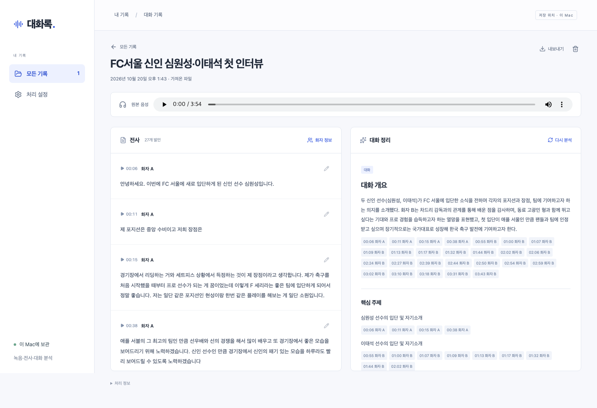
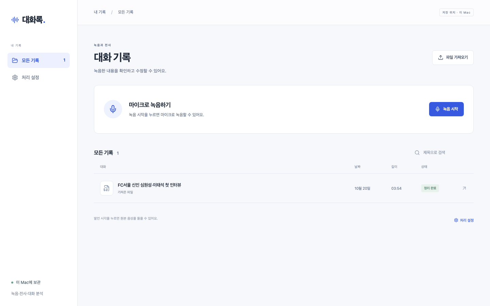
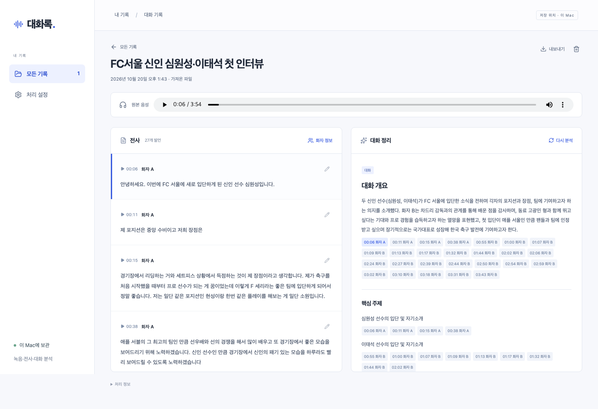
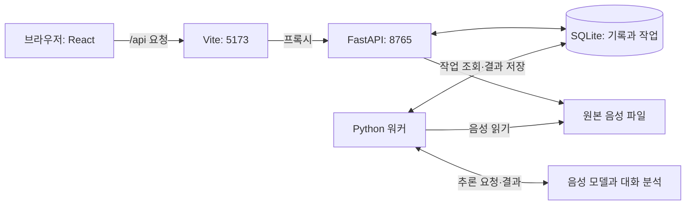

# oh-my-meetinglog

한국어 대화를 녹음하고, 누가 언제 무엇을 말했는지 확인할 수 있는 전사와 대화 기록을 만드는 로컬 웹 앱이다. 맥북의 브라우저와 같은 기기의 Python 서버에서 실행한다.

목표는 **Plaud 없이도 양질의 전사를 얻고, 근거가 보존된 대화 기록을 사용자의 에이전트에 전달하는 것**이다. 이 앱은 녹음·전사·대화 정리·데이터 전달을 담당한다. 견적서 작성, 보고서 초안, PoC 개발, 캘린더·노션 작업은 사용자가 쓰는 Claude Code·Codex 등의 에이전트에서 진행한다.

현재는 녹음·파일 입력, 화자별 전사, 문장 수정과 폼별 대화 정리, 근거 확인, 에이전트 전달용 Markdown·JSON 내보내기를 구현한 단계다. 공개 한국어 인터뷰 한 건으로 실제 로컬 전사·분석과 화면 동작을 확인했다. 전사·화자 구분의 정량적 품질과 장시간 처리 성능은 아직 평가하지 않았다. MCP 직접 연결과 앱에서 에이전트를 실행하는 기능은 없다.

[개발 배경](#왜-만들었나) · [실행 화면](#실행-화면) · [벤치마크](#무엇을-벤치마크했나) · [설계 선택](#어떤-선택을-했나) · [단계별 데이터](#단계별-데이터) · [실행 방법](#실행-방법) · [에이전트에 전달하기](#에이전트에-전달하기) · [다음 목표](#다음-목표) · [학습 문서](docs/learning/README.md)

음성 인식을 처음 공부한다면 [학습 문서](docs/learning/README.md)를 순서대로 읽는다. 파형·통계적 음성 인식·현재 AI의 원리, Plaud의 공개 방식, 우리 모델과 자원 제약, 데이터 평가·질문 응답·에이전트 연결을 예제와 확인 문제로 설명한다.

## 왜 만들었나

Plaud가 녹음을 어떻게 처리하는지, 왜 그런 구조를 선택했는지, 전사 품질을 어떻게 높였는지 직접 만들면서 이해하고 싶었다. 공개 자료를 읽고 구현한 뒤, 제한된 디바이스의 연산 성능과 메모리 안에서 어디까지 개선할 수 있는지 확인하는 프로젝트다.

이를 위해 음성을 받아 텍스트로 바꾸는 과정뿐 아니라, 발언 시각과 화자를 맞추고 원본 음성에서 결과를 확인하는 과정까지 연결한다. 전사나 분석이 틀렸을 때 사람이 수정하고, 수정한 결과를 다시 사용할 수 있어야 한다.

첫 사용 사례는 한국어 1:1 인터뷰·상담이다. 이후 다대다 대화로 범위를 넓힌다. 최종적으로는 대화에서 확인한 요구사항과 조건을 다음 작업의 입력으로 쓴다.

- **견적서 작성:** 대화에 나온 작업 범위, 예산, 일정, 미정 조건을 정리해 견적서 초안을 만든다.
- **PoC 제품 개발:** 요구사항과 제약을 정리하고 개발 에이전트에 전달해 검토할 수 있는 구현으로 연결한다.

이 앱의 범위는 두 흐름에 필요한 대화 데이터를 제공하는 데까지다. 후속 작업의 실행, 회사 자료 접근, 외부 서비스 인증은 사용자의 에이전트가 맡는다. Markdown과 JSON은 전사·분석 버전, 문장 시각과 근거를 함께 전달한다.

## 실행 화면

### 한국어 인터뷰의 실제 로컬 전사·분석

2026-10-20에 **FC서울 신인 심원성 & 이태석 첫 인터뷰**의 전체 음성을 실제 로컬 모델로 처리했다. 원본 영상은 약 3분 55초다. Qwen3-ASR, ForcedAligner, Silero VAD, Nemotron 3와 Ollama `gpt-oss:20b`를 사용했으며 고정 결과를 반환하는 시험 엔진이나 외부 API는 사용하지 않았다.

[](docs/verification/assets/fcseoul-flow.webm)

[데모 영상 열기 또는 다운로드하기 · WebM · 12.08초](docs/verification/assets/fcseoul-flow.webm)

기록 목록 → 전사·분석 결과 → 근거 발언의 음성 시각으로 이동 → JSON 내보내기 → 목록 복귀 순서다. **영상은 처리가 끝난 뒤 촬영한 무음 화면 녹화이며, 모델 처리 대기 시간은 포함하지 않는다.** 이번 한 번의 처리에는 작업 생성부터 완료까지 약 4분 19초가 걸렸다. 다른 기기나 긴 파일의 성능을 예측하는 값은 아니다.

이 화면과 영상은 2026-10-20 당시 버전이다. 현재 버전에는 문장 단위 전사와 폼 선택 흐름이 추가됐으며 정리 화면의 시간 표시는 제거됐다.

결과는 **27개 발언·익명 화자 2개·주제 5개**다. `FC서울` 등 고유명사 오인식과 화자 미확인 구간 1개가 남아 있다. 전사·분석을 수동으로 고치지 않은 실제 출력이며, 정확도 검증이 끝났다는 뜻이 아니다. [실행 환경·오류·검증 범위](docs/verification/2026-10-20-korean-interview-demo.md)를 함께 기록했다.

원본: **FC SEOUL**, [FC서울 신인 심원성 & 이태석 첫 인터뷰](https://www.youtube.com/watch?v=GnxVJrvGhRE), [CC BY 3.0](https://creativecommons.org/licenses/by/3.0/). [Commons의 파일·라이선스 기록](https://commons.wikimedia.org/wiki/File:FC서울_신인_심원성_%26_이태석_첫_인터뷰.webm)을 근거로 사용했다. 변경 내용은 전체 영상에서 음성 추출·FLAC 변환·자동 전사·분석·앱 화면 촬영이다. 제작자나 출연자의 서비스 보증을 의미하지 않는다.

<details>
<summary>기록 목록과 근거 시각 이동 화면</summary>

저장한 기록 목록:



분석의 근거를 누르면 해당 발언을 선택하고 음성 재생 위치를 이동한다:



</details>

<details>
<summary>이전 실행·기능 검증 기록</summary>

- [2026-10-16 로컬 MVP](docs/verification/2026-10-16-local-mvp.md): 한국어 합성 음성 7.38초를 실제 모델로 처리했다. [당시 화면](docs/verification/assets/local-result.png)
- [2026-10-19 브라우저 기능 검증](docs/verification/2026-10-19-readme-demo.md): 6초 무음과 고정 결과를 반환하는 시험 엔진으로 수정·재분석·내보내기를 확인했다. [당시 영상](docs/verification/assets/browser-flow.webm)

</details>

## 무엇을 벤치마크했나

제품 흐름의 참고 대상은 **Plaud**다. 녹음이나 파일 입력에서 전사, 화자 구분, 요약으로 이어지는 사용 흐름을 참고했다. Plaud는 전사·요약과 화자 표시를 공식 문서에서 설명한다. [공식 사용 안내](https://support.plaud.ai/hc/en-us/articles/53793130069657-Transcribe-and-summarize)

전처리에서는 **사람이 듣기 좋은 음성과 전사에 유리한 음성이 다를 수 있다**는 점을 참고했다. Plaud는 재생과 전사에 서로 다른 신호 경로를 사용하는 이유를 공개했다. 이 프로젝트에서도 원본을 보존하고, 강한 잡음 제거를 기본 적용하기 전에 전사 결과로 효과를 확인하려 한다. [Plaud의 기술 설명](https://www.plaud.ai/blogs/news/the-trade-off-between-sounding-good-and-transcribing-accurately)

| 참고한 항목                                | 이 프로젝트의 적용 방향                                      |
| ------------------------------------------ | ------------------------------------------------------------ |
| 녹음·기존 파일을 하나의 처리 흐름으로 연결 | 브라우저 녹음과 파일 가져오기를 같은 기록 형식으로 저장      |
| 화자별 전사와 대화 정리                    | 발언 시각·화자·원문을 보존하고 분석에서 근거 발언을 참조     |
| 수음과 전처리가 전사 품질에 미치는 영향    | 원본과 모델용 파생 음성을 구분하고 전처리 전후의 오류를 비교 |

현재 벤치마크는 공개된 동작과 설계를 참고한 수준이다. Plaud 기기와 같은 입력으로 정확도를 비교하지 않았고, 비공개 모델이나 내부 처리 구조를 재현했다고 주장하지 않는다. 조사 범위와 출처는 [Plaud 음성 전처리 조사](docs/research/2026-10-16-plaud-audio-preprocessing.md)에 정리했다.

## 어떤 선택을 했나

| 선택                                  | 이유와 현재 제약                                                                                                               |
| ------------------------------------- | ------------------------------------------------------------------------------------------------------------------------------ |
| 한국어 1:1 대화부터 시작              | 먼저 전사와 화자 구분을 평가할 조건을 좁힌다. 다대다·겹친 발언은 후속 검증 대상이다.                                           |
| 맥북 웹 + 같은 Mac의 로컬 서버        | 브라우저가 녹음·편집을 맡고 Python이 음성 모델을 실행한다. 현재는 Apple Silicon을 우선 대상으로 한다.                          |
| 녹음 종료 후 처리                     | 실시간 자막보다 녹음 후 검토할 전사의 품질을 우선한다. 실시간 처리는 현재 범위에 포함하지 않는다.                              |
| 로컬 전용을 기본값으로 제공           | 디바이스 안에서 처리할 수 있는 범위를 확인한다. 필요하면 사용자가 자동 선택 또는 외부 API 모드를 설정한다.                     |
| 원본 보존과 버전 관리                 | 원본 음성, 생성 전사, 수정 전사를 보존한다. 수정 후 이전 분석을 최신 결과처럼 표시하지 않는다.                                 |
| 근거 발언이 연결된 분석               | 요약·질문과 답변·합의·할 일을 원문과 함께 확인할 수 있게 한다. 발언에 없는 담당자나 기한을 추정해 채우지 않는다.               |
| 사용자의 에이전트에 데이터 전달       | 앱은 전사와 정리에 집중한다. 사용자가 선택한 에이전트에 파일을 전달하고, 해당 에이전트의 도구와 권한으로 후속 작업을 진행한다. |
| SQLite와 단일 워커                    | 한 사람이 쓰는 로컬 앱에 맞춰 저장과 작업 실행을 단순하게 유지한다. 추론은 HTTP 요청과 분리하고 순차 실행한다.                 |
| 원본과 최소 변환 음성을 기준으로 시작 | 전처리가 짧은 응답이나 자음을 손상시킬 수 있어, 잡음 제거·겹친 음성 분리는 실제 오류 비교 후 결정한다.                         |
| 모델을 교체할 수 있는 구조            | 지금 연결한 조합은 초기 후보다. 실제 품질·시간·메모리 평가에서 부족하면 단계별 모델을 바꾼다.                                  |

소규모 디바이스에서도 충분한 품질을 낼 수 있는지는 아직 검증 중이다. 현재 모델이 최종 선정이거나 가장 정확한 조합이라는 의미는 아니다.

## 어떻게 동작하나



웹은 React·TypeScript로 작성한 단일 페이지 앱이다. Vite가 개발 서버를 제공하고 `/api` 요청을 FastAPI로 전달한다. 웹 화면은 API를 주기적으로 조회해 처리 상태와 결과를 갱신한다. 모델은 Python 워커와 Ollama에서 실행한다.

마이크 녹음 데이터는 약 5초마다 서버에 전송한다. 종료 후 마지막 청크까지 저장·검증하면 작업을 등록한다. 파일 가져오기도 저장 후 같은 작업 흐름으로 들어간다.

워커는 음성 인식·시간 정렬·화자 구분을 마치면 전사까지만 저장한다. 대화 정리는 사용자가 버튼을 누르고 폼을 선택해 별도로 실행한다. 녹음 저장이나 분석 요청이 완료된 뒤에는 브라우저를 닫아도 서버와 워커가 실행 중이면 처리를 계속한다.

### 단계별 데이터

전사 저장 구조와 대화 정리 모델의 입력은 분리한다. **전사는 턴 안에 문장 목록을 저장하고, 모델에는 음성 시간을 보내지 않는다.**

| 단계         | 저장하거나 전달하는 정보                                                                               | 목적                         |
| ------------ | ------------------------------------------------------------------------------------------------------ | ---------------------------- |
| 1. 음성 저장 | 원본과 기록 ID·제목·출처·길이                                                                          | 원본 보존, 재생과 재처리     |
| 2. 전사 저장 | `turns`: 화자 ID와 `sentences`. 문장마다 ID, 원문·수정문, 시작·종료 시각, 검토 표시                    | 문장별 확인·편집과 음성 이동 |
| 3. 정리 입력 | 화자 정의와 순서대로 나열한 짧은 문장 ID·화자 ID·유효 본문                                             | 모델에 필요한 대화만 전달    |
| 4. 대화 정리 | 선택한 폼의 지시로 요약·주제·질문과 답변·합의·미해결 질문·할 일을 생성. 근거는 `evidence_sentence_ids` | 대화 내용과 명시된 조건 정리 |
| 5. 결과 저장 | 정리 내용, 기준 전사 ID, 선택한 `form`, 제공자·모델·프롬프트 버전                                      | 결과 재조회와 기준 추적      |
| 6. 내보내기  | Markdown 또는 `schema_version: 2`의 기록·전사·정리·처리 이력                                           | 다음 에이전트에 자료 전달    |

같은 화자의 연속 발언은 무음 길이·모델 처리 구간·검토 표시만으로 턴을 나누지 않는다. 화자가 바뀌거나 미확인 구간이 나오면 별도 턴으로 둔다. 문장은 전사된 종결 문장부호와 시간 정렬 결과로 구성한다. 단어별 정렬은 음성 처리의 중간 자료이며 최종 전사·내보내기에 단어 목록을 저장하지 않는다.

시간 정렬이 없거나 본문 전체와 맞지 않으면 문장별 시각을 추정하지 않는다. 기존 구간의 본문·시각을 보존하고 `alignment_uncertain`을 표시한다. 외부 전사 API가 단어 시각을 제공하지 않는 경우에도 이 기준을 적용한다. 기존 기록은 저장된 구간을 문장 항목으로 읽어 원래 근거 ID와 수정문을 유지한다. 새 구조로 읽는 과정에서 기존 파일이나 DB 원문을 덮어쓰지 않는다.

모델에 보내는 예시는 다음과 같다. 설명용 대화다.

```text
화자 목록: [{"id":"s1","display_name":"화자 A","role":null}]
대화:
[t1|s1] "초안은 내일까지 보내겠습니다."
[t2|s1] "검토 후 의견을 주세요."
```

수정문이 있으면 그 본문만 전달한다. 음성 시각, 단어 목록, 검토 표시, 수정 전 원문, 전사 버전과 작업 이력은 모델 입력에 포함하지 않는다. 문장·화자 ID는 요청에서 짧게 바꾸고, 결과를 검증한 뒤 원래 ID로 복원한다. 본문 안의 날짜·기한은 유지한다. 정리 결과에는 주제 시간이나 근거 시간을 저장하지 않는다. 근거는 기본으로 숨기며 **근거 보기**를 켰을 때만 버튼을 표시한다. 표시 전환은 모델을 호출하지 않는다. 근거를 누르면 문장 ID로 전사를 찾고 해당 문장 시작으로 이동한다.

전사는 같은 화자의 턴마다 화자·시각·재생 버튼을 한 번 표시하고, 문장들은 줄바꿈으로 이어 쓴다. 문장이나 턴의 재생 버튼을 누르면 해당 문장부터 다음 문장 시작까지 재생한다. 마지막 문장 또는 다음 시작 시각이 현재 시작보다 늦지 않은 구간은 해당 문장 종료 시각에서 멈춘다. 각 문장 편집과 검토 표시는 유지한다. 원본 재생바를 직접 조작하면 구간 재생을 해제하고 연속 재생할 수 있다. 정리의 같은 주제 본문도 문장별 줄바꿈을 유지한 한 덩어리로 표시한다.

검토 정보는 음성 처리 중 감지한 단어에 남기고, 저장할 때 해당 문장에만 집계한다. 단어별 정보가 없는 구버전은 원래 구간의 표시를 보존한다. 기본 화면에는 미확인 화자 이름과 턴당 한 번의 시간 정렬 확인만 표시한다. **검토 정보 보기**를 켜면 해당 문장의 겹침·화자 전환·처리 구간 경계를 볼 수 있다. 미확인 화자에 ‘화자 확인 필요’를 반복 표시하지 않는다. 상세 표시 전환은 전사 수정이나 모델 호출을 발생시키지 않는다. 표시를 줄여도 화자 배정과 겹침 판정 임계값은 바뀌지 않는다.

### 대화 정리 폼

**대화 정리** 또는 **다시 정리**를 누르면 폼 선택 창이 열린다. 폼을 선택하는 것만으로 모델을 호출하지 않으며 **정리 시작**을 눌러 새 분석을 실행한다.

| 폼            | 정리의 초점                                      |
| ------------- | ------------------------------------------------ |
| 회의 정리     | 논의 흐름, 명시된 합의와 후속 할 일              |
| 인터뷰 정리   | 질문과 답변, 답변의 조건과 핵심 발언             |
| 프로젝트 논의 | 요구사항, 작업 범위, 제약·변경 사항과 후속 할 일 |

선택한 폼은 작업 큐·워커·결과에 보존한다. 폼을 바꾸어 다시 실행하면 새 분석 버전이 생긴다. 이전 결과를 단순히 다른 폼으로 표시하는 기능은 제공하지 않는다. RAG·wiki는 연결하지 않는다. 대화 이후에 필요한 프로젝트 자료 조회와 실행은 사용자의 후속 에이전트가 맡는다.

구현 기준: [전사·분석 정의](backend/src/meetinglog/domain.py), [전사 조립](backend/src/meetinglog/transcripts/assembly.py), [정리 입력](backend/src/meetinglog/analysis/input.py), [폼](backend/src/meetinglog/analysis/forms.py), [프롬프트](backend/src/meetinglog/analysis/prompts.py), [내보내기](backend/src/meetinglog/exports.py).

### 현재 로컬 모델 구성

| 단계           | 모델·도구                                                                                                 | 역할                                              |
| -------------- | --------------------------------------------------------------------------------------------------------- | ------------------------------------------------- |
| 디코딩·변환    | FFmpeg·FFprobe                                                                                            | 파일 검사와 16kHz 모노 파생 음성 생성             |
| 발화 구간 감지 | [Silero VAD · MLX](https://huggingface.co/mlx-community/silero-vad)                                       | 음성이 있는 구간 식별                             |
| 음성 인식      | [Qwen3-ASR 1.7B · MLX 8bit](https://huggingface.co/mlx-community/Qwen3-ASR-1.7B-8bit)                     | 한국어 음성을 텍스트로 변환                       |
| 단어 시각 정렬 | [Qwen3-ForcedAligner 0.6B · MLX 8bit](https://huggingface.co/mlx-community/Qwen3-ForcedAligner-0.6B-8bit) | 단어와 원본 음성의 시각 연결                      |
| 화자 구분      | [Nemotron 3 Diarization · MLX](https://huggingface.co/mlx-community/Nemotron-3-Diarization)               | 화자 구간과 전사를 결합                           |
| 대화 분석      | [Ollama `gpt-oss:20b`](https://ollama.com/library/gpt-oss:20b)                                            | 개요·주제·질문과 답변·합의·미해결 질문·할 일 생성 |

음성 모델은 순차 로드한다. 원본의 채널·표본화율은 보존하며 모델용 파생본을 별도로 만든다. 화자·시간 정렬이 불확실한 구간에는 검토 표시를 남긴다.

### 실행 모드

| 모드               | 동작                                                                                                         |
| ------------------ | ------------------------------------------------------------------------------------------------------------ |
| 로컬 전용 · 기본값 | 로컬 모델만 사용한다. 처리 실패 시 외부 API로 전환하지 않는다.                                               |
| 자동 선택          | 로컬을 우선 사용한다. 실행 실패·시간 초과 또는 평가 보고서로 확인된 품질 실패 시 설정된 외부 API로 전환한다. |
| 외부 API           | 설정한 외부 전사·분석 API를 사용한다.                                                                        |

외부 경로의 기본 설정은 음성 `gpt-4o-transcribe-diarize`, 분석 `gpt-5-mini`다. API 키는 서버에서만 사용한다. 자동·외부 모드에서 외부 경로를 실행하면 음성 또는 전사가 제공자에게 전송되며 API 비용이 발생할 수 있다. 품질이 **미검증**이라는 상태와 평가를 **통과**했다는 상태는 구분한다.

## 실행 방법

### 1. 실행 환경 준비

- Apple Silicon Mac. 기존 로컬 모델 실행 확인 환경은 M5 Pro / 메모리 48GB다. 이 용량이 최소 사양이라는 의미는 아니며, 더 작은 기기의 필요 메모리는 미측정이다.
- Python 3.12와 `uv`. 저장소의 `.python-version`을 사용한다.
- Node.js 22.12 이상과 npm.
- FFmpeg·FFprobe, Ollama. 웹 사용은 Chrome을 우선 대상으로 한다.

Homebrew를 사용한다면 도구를 설치하고, 저장소 루트에서 의존성을 준비한다.

```bash
brew install uv node ffmpeg ollama
uv sync --extra speech
npm --prefix web ci
```

### 2. 모델 준비

위 표의 모델 이름은 해당 모델의 다운로드 페이지로 연결된다. 이 앱에서는 아래 명령으로 준비한다. 음성 모델은 파일과 `models/manifest.json`을 함께 준비하므로, 파일을 수동으로 복사하는 대신 `prepare-models`를 사용한다.

Ollama 앱이나 서버가 실행 중이어야 한다. 실행 중인 서버가 없다면 별도 터미널에서 시작한다.

```bash
ollama serve
```

저장소 루트의 다른 터미널에서 모델을 준비한다.

```bash
ollama pull gpt-oss:20b
uv run --no-sync meetinglog prepare-models
uv run --no-sync meetinglog doctor
```

초기 다운로드에는 네트워크와 수 GB 저장 공간이 필요하다. 준비한 음성 모델의 revision은 `models/manifest.json`에 저장한다. 추론 시에는 준비된 경로만 사용하고 모델을 자동 다운로드하지 않는다.

Xet 전송에서 다운로드가 멈추는 환경에서는 다음 명령으로 재시도할 수 있다.

```bash
HF_HUB_DISABLE_XET=1 uv run --no-sync meetinglog prepare-models
```

### 3. 웹·API·워커 실행

```bash
bash scripts/dev.sh
```

[http://127.0.0.1:5173](http://127.0.0.1:5173)을 연다. 스크립트는 다음 세 프로세스를 함께 실행한다.

| 프로세스 | 개별 실행 명령                       | 주소                    |
| -------- | ------------------------------------ | ----------------------- |
| 웹       | `npm --prefix web run dev`           | `http://127.0.0.1:5173` |
| API      | `uv run --no-sync meetinglog serve`  | `http://127.0.0.1:8765` |
| 워커     | `uv run --no-sync meetinglog worker` | 접속용 포트 없음        |

Ctrl+C로 스크립트가 시작한 프로세스를 종료한다. 별도로 실행한 Ollama는 유지한다. 포트가 이미 사용 중이면 기존 실행을 확인한다. 현재 스크립트는 로컬 개발용 실행이며, 서버 배포 설정은 포함하지 않는다.

### 외부 API를 사용하려면

[.env.example](.env.example)을 참고해 저장소 루트의 `.env`에 `OPENAI_API_KEY`를 설정한다. API와 워커를 다시 실행한 뒤 화면의 **처리 설정**에서 모드를 선택한다. 키가 없는 상태에서도 로컬 전용 모드는 사용할 수 있다.

## 사용 방법과 데이터

1. **녹음 시작**으로 마이크 권한을 허용하거나 **파일 가져오기**로 녹음을 선택한다. 입력 상한은 2시간 / 1GB다. 이 상한까지 실제 대화의 처리 품질을 검증한 것은 아니다.
2. 녹음 종료 후 최종 저장이 끝나면 전사·화자 구분을 진행한다. 녹음 중에는 브라우저를 열어 둔다.
3. 전사의 문장이나 재생 버튼을 누르면 해당 문장부터 다음 문장 시작까지 재생한다. **대화 정리**에서 폼을 선택하고 **정리 시작**을 누르면 분석을 실행한다. 정리의 원문을 확인하려면 **근거 보기**를 켠다.
4. 문장과 화자 이름·역할을 수정한다. 전사 수정은 새 버전을 만들며 원문을 보존한다. **다시 정리**에서 폼을 선택해 수정한 전사를 반영한다.
5. **내보내기**에서 에이전트 전달용 Markdown이나 JSON을 받는다. 재분석 전에는 최신 전사에 이전 분석을 섞어 내보내지 않는다.

처리는 취소하거나 원본에서 다시 시작할 수 있다. 분석만 실패하면 저장된 음성과 전사를 바탕으로 분석을 재시도한다. 워커가 재시작하면 중단된 작업을 재개한다. 녹음 도중 브라우저가 닫힌 경우에는 ‘저장 미완료’로 남으며 자동 복구하지 않는다. 기록 삭제는 실행 중인 처리를 중지한 뒤 원본·전사·분석을 삭제한다.

| 경로                      | 저장하는 데이터                                                |
| ------------------------- | -------------------------------------------------------------- |
| `data/meetinglog.sqlite3` | 기록, 작업 상태, 전사·분석 버전                                |
| `data/recordings/`        | 원본, 녹음 청크, 재생용 WebM·WAV, 모델용 파생 파일과 엔진 결과 |
| `models/`                 | 준비한 음성 모델과 revision manifest                           |
| `.env`                    | 로컬 설정과 외부 API 키                                        |

위 경로는 Git에서 제외한다. 현재는 한 사람이 같은 Mac에서 쓰는 구성이며 웹과 API는 루프백 주소에서만 수신한다. 로그인이나 앱 자체 파일 암호화는 제공하지 않는다.

## 에이전트에 전달하기

첫 전달 방식은 파일이다. 이 앱에 후속 작업용 모델 계정이나 캘린더·노션 권한을 연결할 필요는 없다.

1. 대화 기록에서 고유명사·수치·날짜와 검토 표시가 있는 발언을 확인한다. 수정했다면 필요에 따라 다시 정리한다.
2. **내보내기 → Markdown · 에이전트 전달용**으로 파일을 받는다. 프로그램에서 구조화된 데이터를 다루려면 **JSON · AI 분석용**을 받는다.
3. 사용 중인 Claude Code·Codex 등에서 해당 파일을 읽게 한다. 파일 첨부를 지원하는 도구는 첨부하고, 로컬 파일을 읽는 도구는 작업 폴더에 두고 경로를 알려 준다.
4. 만들 결과물과 사용할 자료·저장소를 별도로 지정한다. 회사 자료 조회나 외부 서비스 작업에 필요한 연결과 권한은 해당 에이전트에서 설정한다.

| 형식     | 포함하는 정보                                                                                                              | 용도                                          |
| -------- | -------------------------------------------------------------------------------------------------------------------------- | --------------------------------------------- |
| Markdown | 자료 해석 기준, 기록·전사·분석 ID, 대화 정리, 화자·역할, 문장 ID와 밀리초 단위 시간 범위, 수정문·자동 전사 원문, 검토 표시 | 사람이 확인하고 에이전트에 읽히는 문서        |
| JSON     | `schema_version`, 녹음 정보, 전사·분석 버전, 턴 안의 문장·시각·원문·수정문, 정리 폼, 검토 표시, 처리 이력                  | 프로그램·에이전트 도구가 필드별로 읽는 데이터 |

예를 들어 파일과 함께 다음 작업을 요청한다.

```text
이 회의 기록을 읽고 견적서 초안을 작성해.
확정 조건, 제안, 미정 조건을 구분해.
각 판단에 근거 문장 ID를 적어.
자료에 없는 금액·일정·담당자는 확인 질문으로 남겨.
```

같은 파일로 보고서 초안, 개발 요구사항 정리, PoC 작업을 요청할 수 있다. 실제 대화 일시는 별도로 알려 줘야 한다. 기록 생성 시각은 앱 등록 시각이므로 상대 날짜의 기준으로 단정하지 않는다. 분석이 없는 경우에도 전사를 내보낼 수 있다.

내보낸 파일에는 대화 원문이 포함된다. 외부 AI에 전달할 때는 사용자가 전달 범위를 확인한다. 파일 전달 동작은 테스트했지만, Claude Code·Codex가 실제 후속 작업을 얼마나 정확히 수행하는지는 별도 평가 대상이다.

## 검증 상태

| 구분                        | 확인한 범위                                                            | 해석의 한계                                              |
| --------------------------- | ---------------------------------------------------------------------- | -------------------------------------------------------- |
| 실제 로컬 모델 · 2026-10-16 | 짧은 한국어 합성 음성을 입력해 전사·화자 구분·Ollama 분석까지 실행     | 실제 대화의 정확도·장시간 속도·통합 최대 메모리는 미측정 |
| 브라우저 기능 · 2026-10-19  | 테스트 엔진으로 파일 입력, 수정, 재분석, 근거 시각 이동, 내보내기 확인 | 실제 음성 인식 품질을 측정하지 않음                      |
| 한국어 인터뷰 · 2026-10-20  | 실제 모델로 약 3분 55초의 공개 인터뷰 전사·분석·화면 촬영 완료         | 고유명사 오인식·화자 미확인 구간이 있으며 CER·DER 미측정 |
| 사용자 녹음 · 2026-10-21    | 약 28분 ALAC 파일의 재생과 저장된 전사 재분석 확인. 분석 약 11분       | 의미적 정확도 미평가. 입력 분할·시간 초과·재생 오류 수정 |
| 외부 API                    | 요청 형식·분할·재시도 등을 모의 경계에서 검사                          | 유효한 키를 사용한 실제 연결·품질·요금은 미확인          |
| 모바일·장시간 녹음          | 화면 크기별 레이아웃과 입력 상한 구현                                  | 아이폰·Safari·잠금 중 녹음·60분 연속 대화는 미검증       |

문장 ID·화자 ID·기한의 원문 일치 등을 검증하지만, 그 검증만으로 요약의 의미적 정확성까지 보장할 수는 없다. 실제 한국어 대화의 전사 오류율(CER), 화자 구분 오류율(DER), 처리 시간과 메모리를 측정해야 한다.

개발 검사 명령은 다음과 같다. 테스트용 엔진을 사용하므로 음성 모델의 가중치를 준비하거나 유료 API를 호출할 필요는 없다. FFmpeg가 필요하며, 모델 준비 테스트가 직접 사용하는 `huggingface-hub`는 `speech` 선택 의존성에 포함돼 있다.

```bash
uv sync --extra speech
npm --prefix web ci
npm --prefix web exec playwright install chromium
bash scripts/check.sh
```

`scripts/check.sh`는 Python 정적 검사·테스트, TypeScript 타입 검사, 웹 컴포넌트 테스트, 프로덕션 빌드, Playwright 통합 테스트를 실행한다. 패키지 설치와 모델 가중치 다운로드는 별도 단계다. 위 명령은 `prepare-models`를 실행하지 않는다.

OpenAPI에서 TypeScript 계약을 갱신하려면 다음 명령을 사용한다.

```bash
uv run --no-sync meetinglog schema > web/src/lib/schema.json
web/node_modules/.bin/openapi-typescript web/src/lib/schema.json -o web/src/lib/schema.d.ts
```

실제 음성 평가는 정답 전사와 화자 시각이 있는 자료가 필요하다. [평가 방법](evaluation/README.md), [한국어 인터뷰 실행 기록](docs/verification/2026-10-20-korean-interview-demo.md), [기존 로컬 실행 기록](docs/verification/2026-10-16-local-mvp.md), [브라우저 기능 검증 기록](docs/verification/2026-10-19-readme-demo.md)을 참고한다.

[M4A 재생 오류와 분석 입력 구조 리뷰](docs/verification/2026-10-21-analysis-input-review.md)에는 실제 파일에서 확인한 원인, 요청 크기와 분할 개선, 재분석·복구 결과를 기록했다.

[문장 전사·폼별 정리와 컨텍스트 측정](docs/verification/2026-10-22-sentence-forms-context.md): 약 28분 샘플의 저장 전사를 새 구조로 조립해 프로젝트 논의 폼으로 분석했다. 요청별 최대 입력은 8,538 / 32,768토큰(26.1%), 최대 출력 여유 포함 점유율은 38.6%다. 전체 정리는 약 9분 7초였으며 음성 인식 재실행 시간은 포함하지 않는다.

[전사 구간 재생·근거 선택 표시](docs/verification/2026-10-22-transcript-playback.md): 전사 버튼의 재생 미실행을 수정했다. 샘플 문장 클릭 후 452.952~455.544초 재생, 턴별 줄바꿈·편집 유지, 근거 기본 숨김과 표시 전환 시 분석 미호출을 확인했다.

[검토 표시 범위·기본 노출](docs/verification/2026-10-22-review-flags.md): 단어별 검토 정보를 해당 문장에만 적용하고 경계·겹침 사유는 요청할 때 표시한다. 샘플의 검토 표시 문장은 190개에서 156개로 줄었다. 본문·시각·화자·문장 ID와 정리 본문은 유지했으며 재전사·재분석은 하지 않았다. 경고 감소는 정확도 개선 평가 수치가 아니다.

## 다음 목표

이 프로젝트의 개발 범위는 **양질의 전사 → 근거가 보존된 대화 정리 → 사용자의 에이전트에 전달**이다. 전달 이후의 작업과 결과물 생성은 사용자의 에이전트가 맡는다. 아래 항목은 추가 검증·개선 목표다.

| 단계                         | 확인하거나 구현할 내용                                                                                                          |
| ---------------------------- | ------------------------------------------------------------------------------------------------------------------------------- |
| 1. 실제 대화로 품질 평가     | 한국어 인터뷰·상담의 정답 자료를 만들고 전사·화자 오류, 처리 시간, 메모리를 측정한다. 짧은 응답·부정 표현·수치·이름을 확인한다. |
| 2. 디바이스 제약 안에서 개선 | 모델·양자화·분할·전처리 조합을 비교한다. 로컬 처리의 품질과 속도가 부족한 단계는 API 사용을 포함해 판단한다.                    |
| 3. 다대다·장시간 대화 검증   | 겹친 발언, 화자의 재등장, 구간 경계, 60분 대화에서 발언 누락과 화자 ID 유지를 평가한다.                                         |
| 4. 전달 데이터 평가          | Markdown·JSON을 외부 에이전트에 읽히고 조건·변경·근거가 유지되는지 확인한다. 견적서·보고서·PoC 요구사항으로 평가한다.           |
| 5. 반복 전달 편의 검토       | 파일 전달이 실제로 번거로운지 확인한 뒤 읽기 전용 MCP 등 직접 조회 방식을 검토한다. 현재는 미구현이다.                          |

여러 기기에서의 접속과 서비스 확장도 후속 검토 대상이다. 아이폰 접속에는 HTTPS·기기 접근 제어·녹음 중단 복구를 별도로 설계해야 한다. 실시간 자막, 여러 사용자·공유, 시스템·통화 음성 직접 캡처는 현재 범위에 포함하지 않는다.

## 프로젝트 구조와 관련 문서

```text
web/src/                  React 화면, 녹음·재생·편집, API 호출
backend/src/meetinglog/    FastAPI, 저장·버전 관리, 작업 워커, 모델 실행
tests/                    백엔드 검사와 브라우저용 테스트 서버
web/e2e/                  Playwright 브라우저 통합 테스트
evaluation/               실제 음성 평가 형식과 실행 방법
scripts/                  개발 서버 실행과 전체 검사
docs/research/            Plaud·모델·웹 실행 조건 조사
docs/learning/            음성 인식 기초부터 현재 구현·평가·AI 활용까지 학습
docs/verification/        실행 근거, 스크린샷과 데모 영상
```

- [로컬 웹 MVP 설계안](docs/superpowers/specs/2026-10-16-local-conversation-records-design.md)
- [음성 인식과 대화 데이터 학습 과정](docs/learning/README.md)
- [구현 계획](docs/superpowers/plans/2026-10-16-local-conversation-records.md)
- [Plaud 음성 전처리 조사](docs/research/2026-10-16-plaud-audio-preprocessing.md)
- [음성 모델 후보·제약·평가 기준](docs/research/2026-10-16-audio-model-candidates.md)
- [맥북·아이폰 웹 적용성 및 실제 확인 범위](docs/research/2026-10-16-macbook-iphone-web-feasibility.md)
- [프로젝트의 언어와 판단 기준](AGENTS.md)
- [서비스 문구 기준](docs/service-copy.md)
