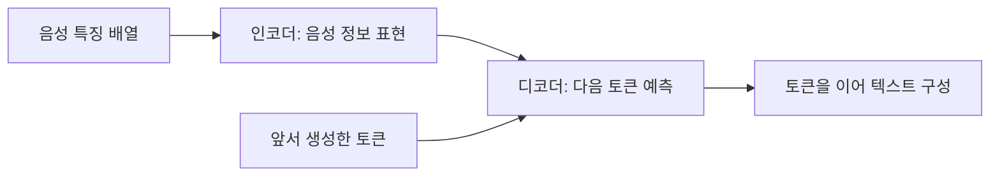

# 2. 음성 인식의 발전과 현재 AI의 원리

이전: [디지털 음성 기초](01-audio-foundations.md) · [읽기 안내](README.md) · 다음: [대화 처리 단계](03-conversation-pipeline.md)

학습 목표는 소리와 텍스트의 관계를 모델이 어떻게 학습하는지 설명하고, 전사 결과가 추정이라는 점을 이해하는 것이다.

## 2.1 ‘AI 이전’이라는 표현의 범위

음성 인식은 최근의 ChatGPT 같은 생성형 AI가 나오기 전부터 존재했다. 이전 시스템에도 통계 모델과 기계학습이 사용됐다. 따라서 역사를 ‘AI 없이 정확히 변환하던 시대’와 ‘AI가 추측하는 시대’로 나누면 잘못 이해하게 된다.

큰 흐름은 다음과 같다. 각 방식은 일정 기간 함께 사용됐으며, 새 방식이 나왔다고 이전 방식이 모두 사라진 것은 아니다.

| 접근                  | 기본 생각                                   | 학습·설계하는 것                     |
| --------------------- | ------------------------------------------- | ------------------------------------ |
| 템플릿 비교           | 소리 특징을 등록된 발음 패턴과 비교         | 발음 예시와 비교 규칙                |
| 통계적 음성 인식      | 가능한 발음 진행과 단어 배열의 확률 계산    | 음향 모델, 발음 사전, 언어 모델      |
| 신경망 기반 음성 인식 | 입력 특징과 텍스트의 관계를 신경망으로 학습 | 신경망 가중치, 출력 단위와 학습 목적 |

초기 패턴 인식·시간 정렬과 HMM·대어휘 인식의 관계는 음성 인식 연구자인 Rabiner의 [강의 구성](https://web.ece.ucsb.edu/Faculty/Rabiner/ece259/speech%20recognition%20course.html)에서도 확인할 수 있다.

## 2.2 템플릿 비교와 시간 정렬

‘일’, ‘이’, ‘삼’을 말한 예시를 등록했다고 가정하자. 새 소리가 들어오면 각각의 특징과 비교해 가까운 후보를 고른다.

같은 ‘삼’도 길게 또는 짧게 말할 수 있다. 시간 위치를 고정해 비교하면 같은 단어를 다르게 판단할 수 있다. **DTW, 동적 시간 워핑**은 두 특징 배열의 진행 속도를 다르게 맞추며 비교하는 방법이다.

제한된 숫자나 명령어를 다루는 문제와, 처음 듣는 사람의 자유로운 회의를 인식하는 문제는 난도가 다르다. 템플릿을 더 등록하는 것만으로 모든 문장·말투·속도 조합을 다루기는 어렵다.

## 2.3 전통적인 통계 시스템

전통적인 대어휘 시스템은 보통 다음 요소를 결합했다.

| 요소      | 답하려는 질문                                    |
| --------- | ------------------------------------------------ |
| 음향 모델 | 이 소리 특징은 어떤 발음과 잘 맞는가?            |
| 발음 사전 | 어떤 발음 배열이 어떤 단어에 대응하는가?         |
| 언어 모델 | 이 단어 다음에 어떤 단어가 나올 가능성이 높은가? |
| 디코더    | 가능한 후보 중 점수가 높은 문장은 무엇인가?      |

**HMM, 숨은 마르코프 모델**은 직접 관찰할 수 없는 발음 상태가 시간에 따라 이동하고, 각 상태에서 소리 특징이 관찰된다고 모델링한다. 숨은 상태의 진행을 실제 발음과 대응시킨다. [HMM 원리와 음성 인식 응용 논문](https://www.cs.cmu.edu/~durand/03-711/Readings/Rabiner89.pdf)

대표적인 통계적 관점은 아래 식으로 표현할 수 있다.

```text
음성 X가 주어졌을 때 가장 가능성 높은 문장 W를 찾는다.

P(W | X) ∝ P(X | W) × P(W)

P(X | W): 그 문장을 말했을 때 이 소리가 나올 가능성
P(W): 그 문장 자체가 나올 가능성
∝: 비례한다는 뜻
```

음향적으로 비슷한 후보가 있을 때 문장 확률이 선택에 영향을 준다. 구체 시스템은 발음 상태, 점수 가중치, 검색 최적화 등을 더 사용한다. 위 식은 이해를 위한 기본 형태다.

## 2.4 신경망은 무엇을 학습하는가

신경망은 입력 숫자를 여러 단계의 계산에 통과시키는 함수다. 계산에 사용하는 조정 가능한 값들을 **가중치**, 또는 **파라미터**라고 한다.

학습에서는 다음 과정을 반복한다.

1. 음성과 그에 대응하는 정답 텍스트를 준비한다.
2. 모델이 음성에서 텍스트를 예측한다.
3. 예측과 정답의 차이를 손실 함수로 계산한다.
4. 손실을 줄이는 방향으로 가중치를 조금 바꾼다.

실제 대규모 모델은 정답이 있는 자료 외에 자동 생성한 정답, 여러 과제, 사전학습 등을 함께 사용하기도 한다. 이 설명은 기본적인 지도학습 과정을 단순화한 것이다.

**학습**은 가중치를 만드는 과정이고, **추론**은 만들어진 가중치로 새 입력을 처리하는 과정이다. 우리 앱은 공개 모델의 추론을 실행한다. 사용자가 녹음 한 개를 추가하거나 전사문을 수정할 때 모델 가중치를 다시 학습하지 않는다.

## 2.5 현재 모델의 대표 구조

음성 인식 모델의 출력 방식은 하나가 아니다.

| 구조          | 핵심 아이디어                                            |
| ------------- | -------------------------------------------------------- |
| CTC           | 시간별 기호 예측을 반복·공백 처리 규칙으로 텍스트와 연결 |
| 인코더·디코더 | 음성을 표현한 결과를 참고해 텍스트 조각을 순서대로 생성  |
| Transducer    | 음성의 진행과 앞서 출력한 기호를 결합해 다음 출력을 결정 |

CTC에서 ‘공백’은 모델 내부의 출력 없음 기호이며 띄어쓰기 문자와 구분한다. 이런 방식들은 사람 손으로 모든 단어의 시작 시각을 지정해야만 학습할 수 있는 것은 아니다. [CTC 원 논문](https://www.cs.toronto.edu/~graves/icml_2006.pdf)

예를 들어 시간별 출력 경로가 `가, 가, 공백, 나, 나`라면 연속 반복을 합치고 공백을 제거해 `가나`가 된다. `가, 공백, 가`는 `가가`가 된다. 실제 CTC는 가능한 여러 경로의 확률을 합쳐 정답 배열과 연결한다. 이 규칙은 CTC의 예이며 우리 Qwen 디코더의 출력 규칙을 설명한 것은 아니다.

Whisper는 인코더·디코더 Transformer를 사용한다. 입력 음성 특징에서 정보를 추출하고, 그 정보와 앞서 생성한 출력을 참고해 다음 **토큰**을 예측한다. 토큰은 문자나 단어 조각 같은 모델의 텍스트 단위다. 토큰 하나가 항상 한 단어 또는 한글 한 글자인 것은 아니다. [Whisper 모델 설명](https://arxiv.org/html/2212.04356v1#S2.SS2)

Transformer의 핵심 계산 중 하나인 **attention**은 여러 입력 위치의 정보에 가중치를 주어 결합한다. 출력 시점마다 관련 음성 구간의 정보를 다르게 참고할 수 있다. 이는 학습된 숫자 계산이며, 중요하다고 판단한 위치가 항상 올바르다는 보장은 없다.



이 모델들이 매번 ‘음소 → 단어 → 문장’을 명시적인 별도 결과로 내놓는 것은 아니다. 중간 표현을 신경망 안에서 학습할 수 있다. 반대로 신경망을 전통적인 HMM의 일부로 사용하는 혼합 구조도 가능하다.

## 2.6 우리 Qwen3-ASR은 어떻게 연결되는가

Qwen3-ASR은 음성 특징을 처리하는 AuT 인코더, 표현을 연결하는 projector, 언어 모델을 결합한다. 공식 기술 보고서는 128차원 Fbank 특징을 사용하는 음성 인코더와 단계별 학습을 설명한다. Fbank는 주파수 대역별 정보를 모은 특징이다. [Qwen3-ASR 구조](https://arxiv.org/html/2601.21337v1#S2.SS1)

프로젝트는 이 모델의 MLX용 8bit 변환판을 사용한다. 모델 개발자의 원본, 실행 라이브러리, 변환된 체크포인트는 서로 구분한다. ‘Qwen3-ASR 사용’만 기록하면 어떤 가중치와 실행 환경을 사용했는지 재현하기 어렵다.

현재 설정은 [config.py](../../backend/src/meetinglog/config.py), 실행 연결은 [local_speech.py](../../backend/src/meetinglog/engines/local_speech.py)에 있다. 대화 분석용 Ollama 모델은 이 음성 인식 모델과 별개다.

## 2.7 자연스러운 문장이 틀릴 수 있는 이유

음성 모델은 실제로 말한 단어의 확률을 추정한다. 잡음이나 발음이 모호하면 문맥상 그럴듯한 후보를 선택할 수 있다. 원문에 없는 내용 생성, 반복, 구간 앞뒤 단어 누락은 실제 음성 모델에서 보고된 실패 유형이다. [Whisper의 한계](https://arxiv.org/html/2212.04356v1#S6)

그래서 ‘문장이 자연스럽다’는 것만으로 정확성을 판단하지 않는다. 특히 아래 정보는 원본으로 확인한다.

- 300만 원과 500만 원 같은 수치.
- ‘한다’와 ‘안 한다’ 같은 부정.
- ‘가능하다’와 ‘승인되면 가능하다’ 같은 조건.
- 제품명·인명·약어.

## 2.8 확인 문제

1. 녹음 파일을 추가할 때마다 이 앱이 모델을 새로 학습하는가?
2. HMM 방식에도 문맥상 더 가능성 높은 문장을 고르는 과정이 있었는가?
3. 토큰 수와 한국어 글자 수를 항상 같다고 계산해도 되는가?

<details>
<summary>해설</summary>

1. 아니다. 준비된 가중치로 추론한다. 전사 수정도 현재는 데이터 버전 변경이다.
2. 있었다. 별도 언어 모델이 단어 배열의 가능성을 제공할 수 있다.
3. 안 된다. 모델의 토크나이저와 입력 문자열에 따라 달라진다.

</details>

다음: [3. 대화를 처리하는 여러 작업](03-conversation-pipeline.md)
