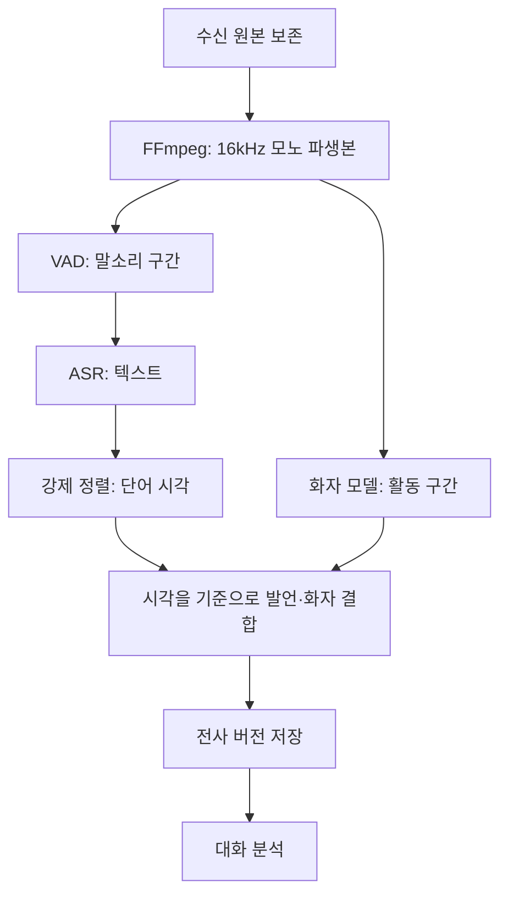

# 3. 대화를 처리하는 여러 작업

이전: [음성 인식 원리](02-speech-recognition.md) · [읽기 안내](README.md) · 다음: [Plaud와 비교](04-plaud-and-our-choices.md)

학습 목표는 ‘음성을 처리한다’는 말을 여러 입출력으로 나누고, 어느 단계의 오류인지 설명하는 것이다.

## 3.1 하나의 모델이 모든 문제를 해결하지는 않는다

‘안녕하세요’라는 텍스트를 얻는 것과, 누가 언제 말했는지 아는 것은 다른 작업이다. 모델에 따라 여러 작업을 한 번에 처리하기도 하지만, 입출력의 구분은 유지해야 한다.

| 작업            | 입력 → 출력                             | 해결하지 못하는 것                    |
| --------------- | --------------------------------------- | ------------------------------------- |
| 디코딩·리샘플링 | 음성 파일 → 정해진 형식의 파형          | 발언 내용 인식                        |
| VAD             | 파형 → 음성이 있는 시간 구간            | 발언 텍스트·화자 이름                 |
| ASR             | 파형 → 텍스트                           | 항상 정밀 시각·화자를 제공하지는 않음 |
| 강제 정렬       | 파형과 주어진 텍스트 → 단어별 시각      | 텍스트가 실제 발언과 맞는지 판정      |
| 화자 구분       | 파형 → 화자별 활동 시간                 | 실제 이름 식별·깨끗한 사람별 파형     |
| 음원 분리       | 섞인 파형 → 소스별 파형                 | 회의 전체에서의 화자 신원 유지        |
| 대화 분석       | 전사와 메타데이터 → 요약·사실·후속 작업 | 누락된 음성 내용의 확실한 복원        |

우리 앱은 이 작업들을 조합한다. [로컬 음성 처리 코드](../../backend/src/meetinglog/engines/local_speech.py)

## 3.2 VAD: 어디에 말소리가 있는가

VAD는 Voice Activity Detection의 약자다. 빈 회의실의 소리와 발언이 있는 구간을 구분해 ASR에 전달할 범위를 정하는 데 사용한다. Silero VAD는 이런 음성 활동 검출을 위한 공개 모델이다. [Silero 공식 저장소](https://github.com/snakers4/silero-vad)

우리 설정은 최소 음성 길이 100ms와 앞뒤 여유 200ms를 요청한다. 검출 구간의 간격이 0.4초 이하면 합치고, 최대 30초의 처리 창을 만든다. 인접 창은 0.8초 겹친다. 짧은 응답을 일괄 제거하지 않고 구간 경계의 발음을 보존하려는 설정이며, 효과는 실제 대화로 검증해야 한다.

중요한 시간 단위를 구분한다.

| 단위               | 현재 코드의 예         | 목적                  |
| ------------------ | ---------------------- | --------------------- |
| 브라우저 저장 청크 | 약 5초마다 전송        | 녹음 데이터 저장      |
| ASR 처리 창        | 최대 30초, 0.8초 겹침  | 음성 모델 입력 분할   |
| 분석 입력 묶음     | 기본 16,000바이트 기준 | 텍스트 분석 입력 제한 |

브라우저가 5초마다 저장한다고 5초마다 실시간 전사가 되는 것은 아니다. 우리 앱은 녹음 종료 후 처리한다.

## 3.3 강제 정렬: 이 단어는 언제 들렸는가

ASR이 ‘다음 주 금요일까지 검토합니다’를 출력했다고 하자. 강제 정렬은 이 텍스트와 파형을 함께 받아 각 단어가 대응하는 시간을 추정한다. Qwen3-ForcedAligner도 텍스트와 음성을 연결해 시각을 추정하는 모델이다. [공식 모델 설명](https://huggingface.co/Qwen/Qwen3-ASR-1.7B)

정렬이 성공해도 텍스트가 정답이라는 보장은 없다. ‘목요일’을 ‘금요일’로 잘못 전사했다면 잘못된 단어에 시각을 붙일 수 있다. 정렬 모델의 목적은 텍스트의 사실성 검증과 다르다.

처리 창이 원본의 60초 위치에서 시작하고 창 안의 단어가 2.4초에 있다면, 원본 시각은 62.4초다. 이 **오프셋**을 더해야 재생 위치가 맞는다.

## 3.4 화자 구분: 누가 언제 말했는가

**Diarization, 화자 구분**은 말소리를 화자 A·B 같은 식별자로 나누고 활동 구간을 찾는 작업이다. 화자 A의 실제 이름이 ‘김민수’라는 사실을 자동으로 알게 되는 것은 아니다.

우리 앱은 diarizer의 화자 구간과 정렬된 단어의 시간을 비교한다. 교집합을 기준으로 화자를 배정하며, 겹침이나 근거 부족을 표시한다. [화자 배정 코드](../../backend/src/meetinglog/recordings/alignment.py)

예를 들어 A는 10.0~12.0초, B는 11.5~13.0초에 말한다면 11.5~12.0초는 동시 발화다. 이 구간에 있는 단어를 강제로 한 사람에게 배정하면 잘못된 담당자나 동의 판단으로 이어질 수 있다.

현재 로컬 경로는 Nemotron-3-Diarization의 MLX 변환판을 사용한다. 모델의 전체 화자 수·겹침 처리 능력과 우리 실제 대화에서의 성능은 따로 검증해야 한다. 가변 길이 음성을 처리한다는 설명이 화자 수 무제한을 뜻하지 않는다. [사용 체크포인트](https://huggingface.co/mlx-community/Nemotron-3-Diarization)

전사를 원본에서 다시 생성하면 우리 앱은 화자 ID를 새로 만든다. 이전 실행의 A와 새 실행의 A가 같은 사람이라고 단정하지 않기 때문이다. 이름을 다시 지정해야 할 수 있다.

## 3.5 잡음 제거·음원 분리·빔포밍

세 작업은 출력이 다르다.

- **잡음 제거·음성 개선:** 에어컨 같은 소음을 줄이는 방향으로 파형을 바꾼다.
- **음원 분리:** 섞인 소리를 여러 소스 파형으로 나눈다. ‘보컬과 반주’와 ‘대화 참여자 둘’은 서로 다른 문제다.
- **빔포밍:** 위치가 다른 여러 마이크의 신호 차이를 사용해 특정 방향에 초점을 맞춘다.

마이크 여러 개의 원시 채널을 확보해야 가능한 처리를, 모노 파일을 복제해서 재현할 수는 없다. 공개 MVDR 예제도 다채널 신호의 공간 정보를 사용한다. **이 예제가 Plaud의 실제 알고리즘이라는 뜻은 아니다.** [TorchAudio MVDR 설명](https://docs.pytorch.org/audio/main/tutorials/mvdr_tutorial.html)

전처리는 신호를 바꾸므로 발음의 일부를 손상시킬 수 있다. 채택 여부는 듣기 좋은 정도와 전사 오류를 각각 측정해 판단한다. 원본을 보존하면 전처리를 바꿔 다시 비교할 수 있다.

## 3.6 우리 앱의 파이프라인

그림은 데이터 의존 관계다. 실제 로컬 코드는 큰 모델을 순차 로드·해제한다. 화자 모델은 VAD로 잘라낸 창마다 새로 화자를 정하는 대신, 파생 음성 전체에 한 번 `generate()`를 호출한다. 이것이 전역 화자 정확도나 내부 스트리밍 처리를 검증했다는 뜻은 아니다.

처리 창이 겹치면 같은 단어를 두 번 인식할 수 있다. 현재 코드는 시간과 문자열이 맞는 경계 단어를 중복 제거한다. 이 과정에서도 실제 반복 발언을 잘못 지우는지 평가해야 한다.

## 3.7 불확실성을 데이터로 남긴다

현재 전사에는 다음 검토 표시가 생길 수 있다.

| 표시                  | 해석                                   |
| --------------------- | -------------------------------------- |
| `unknown_speaker`     | 화자를 확실히 배정하지 못함            |
| `overlap`             | 둘 이상의 화자가 겹치는 것으로 판단    |
| `speaker_boundary`    | 단어가 여러 화자 구간 경계에 걸침      |
| `alignment_uncertain` | 원문과 정렬 결과의 대응이 불확실       |
| `boundary_review`     | 겹친 처리 창 경계의 중복 처리가 있었음 |

표시가 없다는 사실만으로 오류가 없다고 결론내리지 않는다. 현재 `Word`에는 검증된 신뢰도 점수가 없다. 엔진이 제공하지 않은 확률을 임의로 만들어 채우면 안 된다.

## 3.8 확인 문제

1. 단어 시각을 얻었으므로 금액 전사가 맞다고 판단해도 되는가?
2. ‘화자 B’가 말한 내용을 찾았으므로 그 사람의 실제 이름도 아는가?
3. 5초 저장 청크, 30초 음성 창, 16,000바이트 분석 묶음은 같은 단위인가?

해설

1. 아니다. 정렬은 주어진 텍스트의 시각을 추정한다. 원문 정확도는 별도다.
2. 아니다. 이름은 사용자의 지정이나 별도 신원 정보가 필요하다.
3. 아니다. 각각 저장·음성 추론·텍스트 분석의 단위다.

다음: [4. Plaud의 공개 방식과 비교 원칙](04-plaud-and-our-choices.md)
