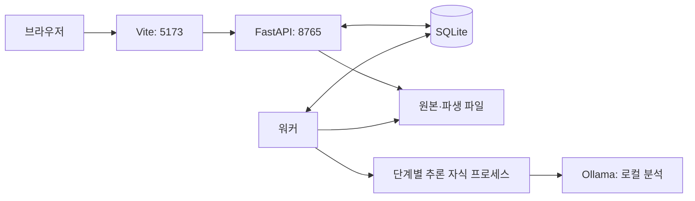

# 5. 우리 프로젝트의 구조와 제한된 환경에서의 선택

이전: [Plaud와 비교](04-plaud-and-our-choices.md) · [읽기 안내](README.md) · 다음: [데이터·평가·에이전트](06-data-evaluation-and-agents.md)

학습 목표는 녹음 버튼을 누른 뒤 어떤 프로그램이 무엇을 하는지 추적하고, 자원 절약의 이점과 비용을 설명하는 것이다. 구현 설명은 2026-10-19 코드 기준이다.

## 5.1 목적과 현재 범위

처음부터 모든 회의 조건을 다루는 대신 한국어 1:1 인터뷰·상담을 첫 대상으로 잡았다. 녹음 종료 후 원본과 비교할 수 있는 전사를 얻는 것이 우선이다. 장기 목적은 검토한 전사를 에이전트가 읽고 견적서·PoC 개발 같은 후속 작업에 사용하는 것이다.

현재 기본 경로는 **로컬 음성 처리와 로컬 대화 분석**이다. 음성을 로컬에서 처리하고 분석은 외부 AI에 맡기기 쉽게 만드는 것은 확장 방향이다. 단계별 제공자를 자유롭게 고르는 화면은 아직 없다.

## 5.2 웹·API·워커의 역할

| 구성         | 하는 일                             | 현재 기술                         |
| ------------ | ----------------------------------- | --------------------------------- |
| 웹           | 녹음, 업로드, 결과 표시, 편집, 재생 | React 19·TypeScript               |
| 개발 웹 서버 | 웹 파일 제공, `/api` 요청 전달      | Vite, `127.0.0.1:5173`            |
| API          | 요청 검사, 파일·작업·전사 버전 관리 | FastAPI·Uvicorn, `127.0.0.1:8765` |
| 데이터베이스 | 기록과 처리 상태·결과 저장          | SQLite                            |
| 워커         | 대기 작업을 가져와 추론 실행        | Python 단일 워커                  |
| Ollama       | 로컬 대화 분석 모델 제공            | 별도 로컬 HTTP 서버               |

**API**는 프로그램끼리 요청과 응답을 주고받는 약속이다. **프록시**는 요청을 다른 서버로 전달하는 중간 역할이다. 웹이 `/api`에 요청하면 Vite가 FastAPI로 전달한다. 웹 서버가 음성 모델을 실행하는 것은 아니다.



워커는 긴 작업을 웹 요청과 분리한다. 녹음의 최종 저장이 완료된 뒤에는 브라우저를 닫아도 API와 워커가 살아 있으면 처리가 계속된다. 녹음 중에 브라우저가 닫히는 문제까지 해결됐다는 뜻은 아니다.

## 5.3 녹음 하나가 처리되는 순서

1. 웹이 마이크 권한을 얻고 `MediaRecorder`로 녹음한다. 약 5초마다 데이터를 서버에 순서대로 전송한다.
2. 종료 시 마지막 청크까지 저장했는지 확인한다. 파일 가져오기도 입력 파일을 저장·검사한다.
3. SQLite에 작업을 등록한다. 워커가 하나씩 가져간다.
4. 음성 단계의 자식 프로세스가 FFmpeg 변환과 음성 모델을 실행한다.
5. 전사는 화자별 턴 안에 문장 목록으로 저장한다. 사용자가 정리 폼을 선택해 요청하면 분석 단계의 자식 프로세스가 구조화 분석을 실행한다.
6. 웹이 상태를 주기적으로 조회하고, 결과와 원본 재생을 제공한다.

현재 초기 작업은 전사까지만 완료한다. 대화 정리 버튼에서 폼을 선택해 분석을 별도로 실행한다. 분석하지 않거나 분석에 실패해도 전사 확인과 내보내기는 가능하다.

코드의 출발점은 [useRecorder.ts](../../web/src/features/recordings/useRecorder.ts), [recordings/api.py](../../backend/src/meetinglog/recordings/api.py), [jobs/runner.py](../../backend/src/meetinglog/jobs/runner.py), [local_executor.py](../../backend/src/meetinglog/engines/local_executor.py)다.

## 5.4 현재 채택한 모델

| 단계      | 현재 모델·도구                                | 선택의 의미와 제약                       |
| --------- | --------------------------------------------- | ---------------------------------------- |
| 형식 변환 | FFmpeg·FFprobe                                | 모델에 필요한 16kHz·모노·PCM 파생본 생성 |
| 발화 검출 | `mlx-community/silero-vad`                    | 말소리가 있는 구간을 찾는 초기 구성      |
| ASR       | `mlx-community/Qwen3-ASR-1.7B-8bit`           | 한국어를 지원하는 공개 모델의 MLX 변환판 |
| 정렬      | `mlx-community/Qwen3-ForcedAligner-0.6B-8bit` | 텍스트와 원본 시각 연결                  |
| 화자 구분 | `mlx-community/Nemotron-3-Diarization`        | 별도 화자 구간 모델을 연결한 초기 구성   |
| 대화 분석 | Ollama의 `gpt-oss:20b`                        | 현재 로컬 분석 기본값                    |

정확한 기본값은 [config.py](../../backend/src/meetinglog/config.py)에 있다. 이 조합이 가장 정확하거나 최종 조합으로 검증됐다는 뜻은 아니다. 사용 가능한 Apple Silicon 실행 경로를 연결한 초기 후보이며 실제 한국어 평가에 따라 교체할 수 있다.

Ollama는 모델 자체가 아니라 모델 실행 도구다. `gpt-oss:20b`는 그 도구가 실행하는 모델이다. 저장소를 복제하는 사람에게 자동으로 설치되는 항목은 아니다.

Whisper 비교용 실행 경로도 있지만 현재 기본값은 Qwen이다. Whisper와의 실제 한국어 비교 평가를 완료해 Qwen의 우위를 입증한 상태는 아니다. 모델을 교체할 때는 언어 지원, Apple Silicon 실행 가능성, 시간 정렬, 실제 오류·속도·메모리를 같은 조건에서 비교한다.

## 5.5 제한된 메모리를 다루는 방법

기존 실행 확인 환경은 **Apple M5 Pro·통합 메모리 48GB**다. 최소 요구 사양으로 측정한 값은 아니다. 작은 기기에서 같은 품질·시간으로 실행된다는 근거도 아직 없다.

### MLX와 양자화

MLX는 Apple Silicon에서 사용할 수 있는 배열·머신러닝 도구다. CPU와 GPU가 공유하는 통합 메모리를 활용한다. 통합 메모리도 용량이 제한돼 있으므로 모델을 무제한으로 올릴 수는 없다. [MLX 통합 메모리 설명](https://ml-explore.github.io/mlx/build/html/usage/unified_memory.html)

**양자화**는 가중치를 더 적은 비트로 표현해 크기를 줄이는 방법이다. 예를 들어 가중치 20억 개를 모두 16bit로만 저장한다는 가정에서는 4GB, 모두 8bit라면 2GB다. 실제 체크포인트에는 다른 정밀도의 부분과 부가 정보가 있어 이 계산과 같지 않다. 품질과 속도의 변화도 측정해야 한다. [MLX 양자화 API](https://ml-explore.github.io/mlx/build/html/python/_autosummary/mlx.nn.quantize.html)

음성의 **16bit PCM**과 모델의 **8bit 가중치**는 서로 다른 대상을 표현한다. 앞의 비트를 줄이는 것과 뒤의 비트를 줄이는 것을 같은 처리로 이해하면 안 된다.

### 순차 실행과 프로세스 분리

현재 로컬 코드는 VAD → ASR → 정렬 → 화자 모델 순서로 사용한 모델을 해제한다. 음성 단계와 분석 단계를 별도 자식 프로세스로 실행한다. Ollama 분석 요청은 `keep_alive: 0`을 사용하며 종료 시 모델 해제를 다시 요청한다. 분석 시간 초과·취소에도 별도 해제 처리가 있다. GPU 캐시 정리와 프로세스 종료를 활용해 여러 큰 모델의 동시 상주를 줄이려는 구성이다.

현재 음성 단계가 시작하기 전에 사용자가 다른 작업에서 올린 Ollama 모델까지 항상 해제하는 것은 아니다. 같은 Mac의 다른 프로그램과 프로세스도 통합 메모리를 사용한다.

모델을 반복 로드하는 비용이 생기므로 지연 시간이 늘 수 있다. 따라서 ‘더 빠르다’고 주장하는 선택은 아니다. 메모리와 시간의 교환이다.

단일 워커는 동시에 여러 회의를 추론하지 않는다. 경쟁과 메모리 급증을 줄이는 대신 대기 시간이 생긴다. ASR 입력을 짧은 창으로 나눠도 현재 코드는 전체 파생 파형과 중간 결과를 보관한다. 입력 길이와 무관하게 메모리가 일정한 완전 스트리밍 구현은 아니다.

근거: [모델 로드·해제](../../backend/src/meetinglog/engines/local_speech.py), [단계 실행](../../backend/src/meetinglog/engines/local_executor.py), [워커와 자식 프로세스](../../backend/src/meetinglog/jobs/runner.py).

## 5.6 왜 강한 잡음 제거를 기본으로 넣지 않았는가

원본을 보존하고 모델에 필요한 형식 변환부터 적용한다. 먼저 기준 결과를 확보해야 추가 잡음 제거가 전사를 개선하는지 비교할 수 있기 때문이다.

이 선택은 모든 입력에서 전처리가 필요 없다는 주장과 다르다. 잡음·배경 음악·겹친 발화가 실제 실패 원인으로 확인되면 해당 작업에 맞는 처리를 비교한다. 녹음 후 처리를 우선한 것도 실시간 제약보다 검토 가능한 전사를 먼저 확보하기 위한 범위 선택이다.

## 5.7 분석 방식과 현재 한계

| 모드         | 동작                                            |
| ------------ | ----------------------------------------------- |
| `local_only` | 로컬만 사용, 실패해도 외부로 자동 전환하지 않음 |
| `auto`       | 로컬 우선, 설정된 외부 경로로 전환 가능한 정책  |
| `api`        | 설정한 OpenAI 경로 사용                         |

현재 외부 기본 설정은 전사 `gpt-4o-transcribe-diarize`, 분석 `gpt-5-mini`다. **코드에 기록된 기본값**이며 최신 모델 추천이나 현재 계정에서의 사용 가능성 보장이 아니다. 실제 API 연결·비용·품질은 아직 검증하지 않았다.

전사와 분석은 별도 작업이다. 처리 설정을 변경한 뒤 기존 전사를 다른 모드로 정리할 수 있다. Gemini·Claude·CLI·MCP 연결도 구현되지 않았다.

품질 미검증은 ‘실패를 측정했다’는 뜻이 아니다. 현재 정책은 모델 revision과 평가 보고서가 연결된 품질 상태를 구분한다. [실행 정책](../../backend/src/meetinglog/engines/policy.py)

## 5.8 저장과 재현

| 위치                      | 내용                                     |
| ------------------------- | ---------------------------------------- |
| `data/meetinglog.sqlite3` | 기록, 작업, 전사·분석 버전               |
| `data/recordings/`        | 수신 원본, 녹음 청크, 파생본, 엔진 결과  |
| `models/manifest.json`    | 모델 저장소·revision·파일 크기·로컬 경로 |
| `.env`                    | 서버 설정과 API 키                       |

모델의 **revision**은 다운로드한 버전을 식별하는 값이다. 현재 준비 검사는 파일 존재·크기와 설정을 확인한다. 파일 크기 검사가 내용 전체의 암호학적 해시 검증과 같지는 않다. 준비된 모델만 추론에 사용하며 실행 중 자동 다운로드는 막는다. [모델 준비 코드](../../backend/src/meetinglog/engines/models.py)

이 데이터·모델·가상 환경 경로는 Git에서 제외된다. 다른 사람이 저장소를 복제하면 의존성과 모델을 별도로 준비해야 한다.

## 5.9 실행 흐름 직접 확인하기

Apple Silicon Mac, Python 3.12와 uv, Node.js 22.12 이상·npm, FFmpeg·FFprobe, Ollama를 준비한다. 아래 명령은 저장소 루트에서 실행한다. 패키지와 수 GB 이상의 모델을 내려받으므로 학습 문서를 읽는 데 필수인 단계는 아니다.

```bash
uv sync --extra speech
npm --prefix web ci
```

Ollama 서버가 실행 중이지 않다면 별도 터미널에서 시작한다.

```bash
ollama serve
```

다른 터미널에서 모델을 준비하고 상태를 확인한다.

```bash
ollama pull gpt-oss:20b
uv run --no-sync meetinglog prepare-models
uv run --no-sync meetinglog doctor
bash scripts/dev.sh
```

브라우저에서 `http://127.0.0.1:5173`을 연다. `dev.sh`는 웹·API·워커를 함께 시작한다. Ollama 설치·시작이나 모델 다운로드를 대신하지 않는다. `doctor`의 `ready`도 파일·서버 준비 상태이며 정확도 합격 표시가 아니다.

VAD 준비 오류라면 음성 패키지와 모델 manifest를 확인한다. 분석 오류라면 별도로 Ollama 서버와 선택 모델을 확인한다. 저장소 루트가 달라지면 상대 경로로 찾는 `models/`·`data/`도 달라질 수 있다.

## 5.10 어디까지 확인했는가

| 항목             | 현재 근거와 한계                                                                 |
| ---------------- | -------------------------------------------------------------------------------- |
| 모델 연결        | 합성 음성과 약 3분 55초의 공개 한국어 인터뷰 1건으로 실제 로컬 전사·분석 확인    |
| 웹 기능          | 시험 엔진으로 수정·재분석을 검사하고, 실제 인터뷰 결과로 근거 이동·내보내기 확인 |
| 실제 대화 정확도 | 정답이 있는 한국어 인터뷰·상담 평가 미완료                                       |
| 장시간·다대다    | 60분 연속 대화·겹침·전역 화자 유지 미검증                                        |
| 통합 최대 메모리 | 워커와 별도 Ollama를 포함한 실측 미구현                                          |
| 아이폰·Safari    | 실제 기기와 잠금·백그라운드 녹음 미검증                                          |

[합성 음성 실행 기록](../verification/2026-10-16-local-mvp.md), [시험 엔진의 기능 검증](../verification/2026-10-19-readme-demo.md), [실제 한국어 인터뷰 실행](../verification/2026-10-20-korean-interview-demo.md)은 확인 조건이 다르다. 실제 인터뷰에서도 고유명사 오인식과 화자 미확인 구간이 남았으며, 데모 스크린샷을 정량적 정확도의 근거로 쓰지 않는다.

## 5.11 확인 문제

1. `dev.sh`를 처음 실행하면 모든 모델도 자동 다운로드되는가?
2. 8bit 모델을 쓰면 실행 메모리가 파일 크기와 같아지는가?
3. 입력 상한이 2시간·1GB라면 2시간 회의의 품질도 검증됐는가?

<details>
<summary>해설</summary>

1. 아니다. 패키지·모델·Ollama 준비는 별도다.
2. 아니다. 파형·중간 계산·캐시·다른 프로세스 메모리를 더 봐야 한다.
3. 아니다. 코드의 입력 제한과 실제 품질·시간 평가는 다르다.

</details>

다음: [6. AI용 데이터, 평가, 영상 질문과 에이전트 연결](06-data-evaluation-and-agents.md)
