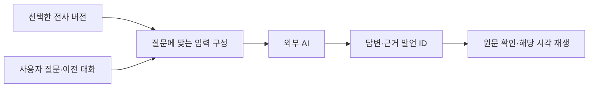

# 6. AI용 데이터, 평가, 영상 질문과 에이전트 연결

이전: [우리 프로젝트](05-project-walkthrough.md) · [읽기 안내](README.md) · [용어집](07-glossary.md)

학습 목표는 ‘AI가 읽을 수 있다’와 ‘AI가 정확히 활용한다’를 구분하고, 전사에서 질문 응답·후속 작업으로 이어지는 최소 구조를 설계하는 것이다.

## 6.1 AI가 읽기 좋은 데이터의 조건

JSON이라고 무조건 좋고 일반 문장이라고 무조건 나쁜 것은 아니다. 작업에 필요한 사실이 충분하고, 정보의 관계가 명확하며, 근거로 돌아갈 수 있어야 한다.

| 조건                | 필요한 이유                                |
| ------------------- | ------------------------------------------ |
| 정확한 본문         | 숫자·부정·조건이 바뀌면 후속 판단도 달라짐 |
| 발언 순서           | 제안·정정·취소의 흐름을 확인               |
| 화자 ID와 표시 이름 | 누가 말했는지 구분하고 이름의 추측 방지    |
| 발언 ID             | 결과의 근거를 특정                         |
| 전사 버전           | 수정 전후 중 무엇을 사용했는지 식별        |
| 불확실성 표시       | 화자·정렬·겹침 문제를 숨기지 않음          |

우리 [도메인 구조](../../backend/src/meetinglog/domain.py)는 문장별 원문·수정문·시각·검토 표시를 저장한다. 수정 시 전사 버전을 새로 만들고, 분석은 자신이 기준으로 삼은 전사 ID를 기록한다.

## 6.2 현재 구조의 예제

아래는 **설명을 위해 만든 `Transcript` 예제**다. 실제 녹음에서 얻은 결과가 아니다. 전사는 화자별 턴 안에 문장 목록을 저장한다. 프로젝트의 전체 JSON 내보내기는 여기에 녹음·분석·처리 이력을 더 감싼 구조다.

```json
{
  "id": "transcript-example-1",
  "recording_id": "recording-example-1",
  "parent_id": null,
  "turns": [
    {
      "id": "turn-1",
      "speaker_id": "speaker-a",
      "sentences": [
        {
          "id": "sentence-1",
          "start_ms": 12000,
          "end_ms": 14000,
          "text_original": "1차에는 로그인과 관리자 화면을 검토하죠.",
          "text_edited": null,
          "review_flags": []
        },
        {
          "id": "sentence-2",
          "start_ms": 14200,
          "end_ms": 17000,
          "text_original": "예산은 300만 원을 제안합니다.",
          "text_edited": null,
          "review_flags": []
        }
      ]
    },
    {
      "id": "turn-2",
      "speaker_id": "speaker-b",
      "sentences": [
        {
          "id": "sentence-3",
          "start_ms": 18000,
          "end_ms": 23000,
          "text_original": "결제 기능은 1차에서 빼고, 예산은 승인 전까지 확정하지 마세요.",
          "text_edited": null,
          "review_flags": []
        }
      ]
    },
    {
      "id": "turn-3",
      "speaker_id": "speaker-a",
      "sentences": [
        {
          "id": "sentence-4",
          "start_ms": 25000,
          "end_ms": 27200,
          "text_original": "금요일까지 견적 초안을 받으면 좋겠습니다.",
          "text_edited": null,
          "review_flags": ["alignment_uncertain"]
        },
        {
          "id": "sentence-5",
          "start_ms": 27500,
          "end_ms": 30000,
          "text_original": "개발 일정은 아직 정하지 않았습니다.",
          "text_edited": null,
          "review_flags": ["alignment_uncertain"]
        }
      ]
    }
  ],
  "speakers": [
    {
      "id": "speaker-a",
      "display_name": "화자 A",
      "role": null
    },
    {
      "id": "speaker-b",
      "display_name": "화자 B",
      "role": null
    }
  ],
  "created_at": "2026-10-19T00:00:00Z"
}
```

이 예제에서 AI에 물을 수 있는 질문과 기대 답은 다음과 같다.

| 질문                      | 근거에 맞는 답                                                                |
| ------------------------- | ----------------------------------------------------------------------------- |
| 예산이 확정됐는가?        | 300만 원은 제안이며 승인 전까지 미확정. 근거 `sentence-2`, `sentence-3`       |
| 결제가 1차에 포함되는가?  | 제외하라는 발언이 있다. 근거 `sentence-3`                                     |
| 금요일은 개발 완료일인가? | 견적 초안을 원하는 시점이며 개발 일정은 미정. 근거 `sentence-4`, `sentence-5` |
| 견적 담당자는 누구인가?   | 명시되지 않았다. 화자 A가 요청했다고 담당자가 A인 것은 아님                   |

문장을 자연스럽게 쓰는 것보다 이런 구분을 지키는지가 중요하다.

## 6.3 보관용 데이터와 분석 입력

보관 데이터에는 문장별 원문·수정 이력·시각을 남긴다. 단어 시각은 음성 엔진의 중간 자료다. 분석 입력은 작업에 필요한 정보를 추려 만든다. 분석 입력이 간결해져도 보관 데이터의 근거를 잃으면 안 된다.

현재 [프롬프트 생성 코드](../../backend/src/meetinglog/analysis/prompts.py)는 화자 정의와 짧은 문장 ID·화자 ID·유효 본문을 텍스트로 보낸다. 음성 시각은 보내지 않는다. 유효 본문은 수정문이 있으면 수정문, 없으면 원문이다. **현재 내부 분석 입력에는 `review_flags`와 전사 버전이 포함되지 않는다.** 전체 JSON 내보내기에는 이 정보가 남아 있지만 내부 분석과 내보내기를 같은 형식으로 가정하면 안 된다.

분석 요청에서는 영구 UUID를 `t1`, `s1` 같은 짧은 참조로 바꾼다. 분석 결과의 근거·담당자 ID는 원래 ID로 복원하고 검증한 뒤 저장한다. 저장용 원문이나 ID를 바꾸는 작업은 아니다.

외부 AI 전달용 형식을 개선한다면 전사 버전·검토 표시를 함께 보내고, 긴 UUID나 단어 목록의 필요성을 작업별로 비교할 수 있다. 식별자를 짧게 바꾼다면 원래 ID로 돌아갈 대응 관계를 유지해야 한다. 이는 후속 제안이며 현재 구현 기능은 아니다.

자동 요약·정리문을 만들더라도 발언 원문을 덮어쓰지 않는다. ‘승인되면 가능하다’를 ‘가능하다’로 바꾼 데이터는 읽기 쉬워도 의미가 달라진다.

## 6.4 검증을 세 층으로 나눈다

### 구조 검증

필드·타입·ID·시각 범위를 검사한다. 존재하지 않는 발언을 인용하는 문제를 자동으로 잡을 수 있다. 현재 [grounding.py](../../backend/src/meetinglog/analysis/grounding.py)는 문장 ID, 화자 ID와 기한 표현의 원문 일치 등을 확인한다. 음성 시각은 전사 저장 시 검증한다.

하지만 존재하는 `sentence-3`를 인용하면서 ‘예산 승인 완료’라고 써도, 그 결론의 의미적 타당성까지 현재 검사가 판정하지는 않는다. **근거 ID 유효성과 근거가 결론을 뒷받침하는지는 다른 검사다.**

### 음성·전사 검증

사람이 원본을 듣고 만든 정답 전사와 화자 시각을 사용한다.

| 지표 | 기본 의미                                        | 주의점                                         |
| ---- | ------------------------------------------------ | ---------------------------------------------- |
| CER  | 정답 문자 대비 치환·삭제·삽입 오류 비율          | 적은 문자 오류가 큰 의미 오류를 만들 수 있음   |
| WER  | 단어 단위의 치환·삭제·삽입 오류 비율             | 한국어 단어 경계·띄어쓰기 규칙에 영향받음      |
| DER  | 화자 혼동·발화 누락·잘못 검출한 발화 시간의 오류 | 겹침·경계 허용·화자 ID 대응 규칙을 명시해야 함 |

```text
CER = (치환 문자 수 + 삭제 문자 수 + 삽입 문자 수) / 정답 문자 수

정답 100글자에 치환 3, 삭제 1, 삽입 2라면 CER = 6%.
```

현재 프로젝트는 CER 계산 시 NFC 정규화 후 공백·문장부호를 제외하며 숫자·부정을 유지한다. DER은 경계 허용 0초, 겹침을 포함해 최종 전사 발언 기준으로 계산한다. 무음의 정답 길이가 0인 경우는 CER로 나누지 않고 별도의 실패 항목으로 다룬다. [프로젝트 평가 코드](../../backend/src/meetinglog/evaluation.py)

NFC는 같은 글자를 서로 다른 유니코드 조합으로 저장한 경우 표현을 맞추는 정규화 방식이다. 예를 들어 한글이 자모 조합으로 저장된 경우와 완성형으로 저장된 경우의 차이를 줄인다. 맞춤법을 교정하거나 금액을 고치는 작업은 아니다.

### AI 활용 검증

실제 목적에 맞는 정답을 만든다. ‘예쁜 회의록’ 같은 기준 대신 중요한 사실의 누락, 잘못 추가한 사실, 조건 보존, 근거의 의미를 평가한다. AI 채점을 사용하더라도 사람 정답과의 일치를 확인해야 한다. [OpenAI 평가 가이드](https://developers.openai.com/api/docs/guides/evaluation-best-practices)

예를 들어 맞힌 중요 사실이 10개 중 8개라면 재현율은 80%다. AI가 출력한 사실 10개 중 8개만 맞았다면 정밀도는 80%다. 전자는 누락, 후자는 잘못된 추가와 관련된다. 실제 채점은 ‘사실 하나’의 단위부터 정해야 한다.

## 6.5 무엇을 바꿨을 때 좋아졌는지 확인하기

모델·프롬프트·전처리·데이터 형식을 한 번에 바꾸면 개선 원인을 알기 어렵다. 같은 회의에 대해 다음 비교를 나눈다.

1. **사람 정답 전사와 자동 전사:** 같은 형식·모델·질문으로 비교한다. 음성 처리 오류의 영향을 본다.
2. **현재 형식과 다른 표현:** 본문·화자·시각·불확실성 등 같은 정보를 유지하고 JSON·Markdown 표현을 비교한다.
3. **최소 변환 음성과 전처리 음성:** 같은 음성 모델과 정답을 사용한다. 전처리 효과를 본다.
4. **모델 간 비교:** 같은 전사·질문을 제공한다. 한 모델의 결과만으로 데이터 형식을 보편적인 최선이라고 선언하지 않는다.

먼저 짧은 실제 사례 몇 개로 실패 원인을 찾고, 개선에 쓰지 않은 별도 자료에서 다시 평가한다. 사례에는 수치 정정, 조건부 동의, 취소, 이름, 짧은 응답, 겹침을 포함한다. 생성이 매번 달라질 수 있으므로 모델·설정·프롬프트·입력을 기록하고 필요하면 반복한다.

우리 저장소의 현재 종합 통과 기준은 정답 자료 30분 이상, 별도 60분 연속 녹음, CER·DER 각 10% 이하, 60분 처리 15분 이하, 사람 검토 통과다. **프로젝트가 정한 목표이며 업계 공통 합격선이 아니다.** 실제 자료가 없는 예시 manifest는 미검증을 반환한다. [평가 실행과 사람 검토 형식](../../evaluation/README.md)

## 6.6 1시간 전사를 한 번에 넣을 수 있는가

텍스트 입력의 한도는 녹음 시간보다 **토큰 수**로 판단한다. 발화량·언어·메타데이터에 따라 같은 1시간도 크기가 다르다. 프롬프트·질문·대화 이력과 출력 여유도 고려한다.

현재 앱은 모델의 최대 입력 한도를 자동으로 활용하지 않는다. [chunking.py](../../backend/src/meetinglog/analysis/chunking.py)는 시스템 안내와 실제 전송 메시지를 기본 16,000바이트 기준으로 나누며 발언 일부를 겹친다. 이것은 16,000토큰이 아니다. 단어별 정렬이나 수정 전 원문처럼 모델에 보내지 않는 필드는 분할 크기에 포함하지 않는다. 응답 JSON 스키마와 근거 오류 재시도 안내는 별도로 붙는다.

구간 분석 동안 모델을 유지하며 전체 분석이 끝나면 해제를 요청한다. 구간이나 전체 요약 요청이 완료될 때마다 진행 이벤트를 남긴다. 워커는 분석 진행이 없는 시간을 기준으로 시간 초과를 판단한다. [실제 M4A 오류와 입력 구조 리뷰](../verification/2026-10-21-analysis-input-review.md)에 원인과 측정값을 기록했다.

[analysis/service.py](../../backend/src/meetinglog/analysis/service.py)는 구간별로 분석한 뒤 전체 개요를 합친다. 다른 항목은 합치고 중복을 제거한다. 멀리 떨어진 발언의 취소·변경을 모두 재판정하는 전역 검증은 아니다.

후속 선택은 ‘한도 내 전체 입력’과 ‘분할·검색 입력’을 같은 질문으로 비교해 결정한다. 긴 컨텍스트를 지원한다는 사실만으로 모든 위치의 정보를 똑같이 활용한다고 가정하지 않는다. 과거 연구에서도 정보 위치에 따른 성능 차이가 관찰됐으며, 현재 사용할 모델에서의 영향은 별도 실험 대상이다. [Lost in the Middle 연구](https://arxiv.org/abs/2307.03172)

## 6.7 유튜브처럼 영상·회의에 질문하기

유튜브는 영상 아래의 질문 기능이 Gemini 기반이며 YouTube·웹 정보를 사용한다고 공개한다. 내부 검색 색인과 프레임·음성 처리 구조 전체를 공개한 것은 아니다. [유튜브 공식 안내](https://support.google.com/youtube/answer/14110396?hl=en)

우리는 전사 기반 회의 질문을 다음처럼 구현할 수 있다. **현재 없는 기능의 설계 예**다.



회의 하나가 입력 한도 안에 들어가면 전체 전사와 질문을 전달하는 방법부터 비교할 수 있다. 회의가 많아지면 관련 구간을 찾아 그 근거와 함께 답하게 한다. 이를 **RAG, 검색 증강 생성**이라고 한다. 벡터 검색은 관련 내용을 찾는 방법 중 하나이며 RAG 자체와 같은 뜻은 아니다. [RAG 원 논문](https://arxiv.org/abs/2005.11401)

뜻이 비슷한 구간을 찾는 벡터 검색에는 **임베딩**, 즉 텍스트를 숫자 벡터로 표현하는 모델을 사용할 수 있다. 숫자·제품명 등 정확한 표현을 찾는 검색과 조합할 수도 있다. 현재 프로젝트에 이런 검색·임베딩·질문 응답 기능은 없다.

검색으로 예산 제안만 찾고 나중의 취소 발언을 놓치면 잘못 답할 수 있다. 주변 발언, 변경 내역, 회의 전체의 관련 조건을 확인하는 평가가 필요하다. 답변에 해당하는 기록이 없으면 기록에서 확인할 수 없다고 표시한다.

‘화면의 그래프가 무엇인가?’는 전사문만으로 답할 수 없는 질문이다. 영상 프레임·화면 글자·시각 정보가 추가로 필요하다. Gemini의 공개 API는 음성과 영상 입력을 함께 다루는 경로를 제공한다. 이것이 유튜브 내부 구현과 같다는 뜻은 아니다. [Gemini 영상 입력 설명](https://ai.google.dev/gemini-api/docs/video-understanding)

## 6.8 외부 모델 연결과 데이터 제공의 차이

| 방식              | 모델 인증·실행을 담당하는 쪽          | 현재 상태                                       |
| ----------------- | ------------------------------------- | ----------------------------------------------- |
| 앱이 API 호출     | 우리 서버가 제공자 인증과 요청을 처리 | OpenAI 경로 구현, 실연결 미검증                 |
| 앱이 CLI 호출     | 로그인한 CLI와 우리 실행 코드         | 미구현                                          |
| 파일 내보내기     | 사용자가 파일을 받은 AI 도구          | 근거·버전·검토 표시를 포함한 Markdown·JSON 구현 |
| MCP로 데이터 제공 | 외부 AI 도구가 우리 데이터 읽기       | 미구현                                          |

CLI는 명령줄 도구다. 클라우드 AI의 CLI를 로컬에서 실행해도 모델 추론은 제공자의 서버에서 일어날 수 있다. API 키 입력과 계정 로그인은 인증 방식의 차이이며, 외부로 전사문이 전송되는지와 별도로 판단한다.

계정 인증을 연결하는 예로 [OpenCode](https://opencode.ai/docs/providers/)가 있다. 제공자별 지원·제한을 각각 다루므로 모든 구독을 공통 로그인으로 연결할 수 있다고 가정하면 안 된다. Anthropic은 사전 승인 없이 제삼자 제품에 claude.ai 로그인·구독 한도를 제공하는 것을 허용하지 않는다고 안내한다. [Claude Agent SDK 안내](https://code.claude.com/docs/en/agent-sdk/overview)

**MCP는 모델을 제공하는 기능이 아니라 AI 도구가 데이터·기능에 접근하는 규약**이다. 외부 에이전트가 회의 목록 조회, 전사 읽기, 근거 구간 확인을 하게 만들 수 있다. 실제 예로 공개 프로젝트 [Soufflé](https://github.com/damione1/souffle#own-your-data)는 내보내기와 읽기 전용 MCP를 함께 제공한다.

MCP만 추가했다고 녹음 종료 후 자동으로 견적서를 작성하지는 않는다. 자동 시작 조건, 결과 저장, 실패 처리, 필요한 후속 도구가 더 있어야 한다.

## 6.9 지금 목적에 맞는 진행 순서

현재 프로젝트는 대화 기록을 사용자의 에이전트에 전달하는 데까지를 범위로 정했다. 견적서·보고서·PoC 생성과 캘린더·노션 작업은 해당 에이전트가 맡는다. 지원하는 내보내기 형식은 [README](../../README.md#주요-기능)에 정리했다.

다음은 현재 상태와 후속 검토 순서다.

1. 실제 녹음의 전사·화자·조건 보존을 평가한다.
2. 전사 완료 후 폼을 선택해 분석을 별도로 실행한다. 회의·인터뷰·프로젝트 논의 폼을 제공하며, 다른 폼으로 정리하려면 새 분석을 실행한다.
3. 버전·화자·시각·근거·검토 표시가 있는 Markdown·JSON을 제공한다. 현재 구현했으며 외부 에이전트의 실제 작업 품질은 미평가다.
4. 반복 사용에서 파일 전달이 번거로우면 읽기 전용 MCP를 검토한다. 현재는 미구현이다.
5. 전달한 대화의 조건·변경·미정 사항이 후속 작업에 유지되는지 평가한다.

견적서에 넣을 금액·일정·담당자는 ‘확정’, ‘제안’, ‘조건부’, ‘미정’을 구분해야 한다. PoC 개발도 대화에 없는 요구사항을 조용히 확정하기보다 미정 질문으로 남겨야 한다. 전사는 후속 작업의 근거이며, 빠진 의사결정을 대신 승인해 주는 데이터는 아니다.

## 6.10 확인 문제

1. JSON 파싱과 근거 ID 검사가 통과하면 요약도 정확한가?
2. 위 대화에서 금요일을 개발 완료일로 견적서에 적어도 되는가?
3. 파일 내보내기와 MCP 중 어느 것이 모델을 직접 제공하는가?
4. CER이 줄었지만 ‘안 한다’를 ‘한다’로 바꾼 오류가 남았다면 충분한 개선인가?

<details>
<summary>해설</summary>

1. 의미적 검증이 남는다. 존재하는 발언을 잘못 해석해 인용할 수 있다.
2. 안 된다. 금요일은 견적 초안을 원하는 시점이며 개발 일정은 미정이다.
3. 둘 다 데이터 제공 경로다. 연결된 외부 AI 도구나 별도 모델 제공자가 추론을 담당한다.
4. 전체 문자 오류 감소만으로 목적 달성을 판단할 수 없다. 중요한 부정·조건 오류를 별도 기준으로 확인해야 한다.

</details>

다음에 다시 읽을 자료: [용어집](07-glossary.md), [평가 실행 안내](../../evaluation/README.md), [전체 프로젝트 README](../../README.md).
