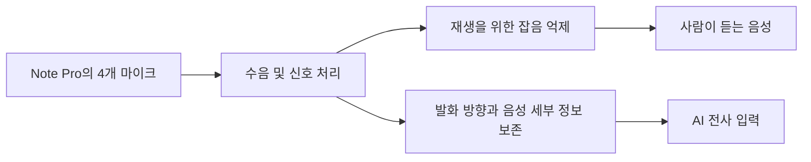
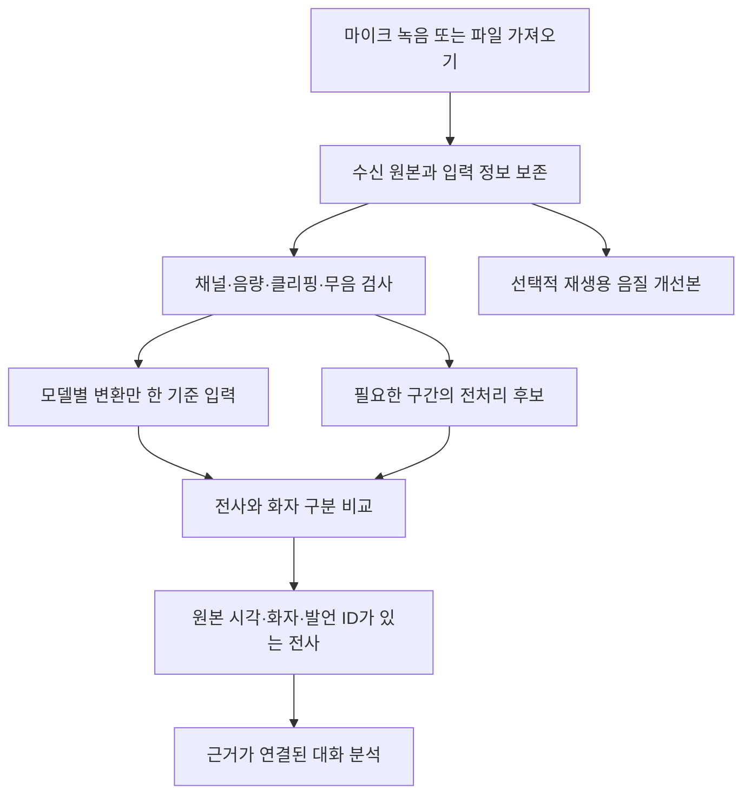

# Plaud 음성 전처리 조사

조사 기준일: 2026-10-16. 공식 제품·지원·개발자 자료를 확인했다. 기기 실험, 비공개 코드 분석, 한국어 성능 측정은 하지 않았다.

관련 문서: [모델 후보 정리](2026-10-16-audio-model-candidates.md), [기존 MVP 설계안](../superpowers/specs/2026-10-16-local-conversation-records-design.md).

후속 확인: [맥북·아이폰 웹 적용성](2026-10-16-macbook-iphone-web-feasibility.md)에 웹에서 가능한 수음·전처리 범위와 실제 검증 상태를 기록했다.

## 1. 확인한 핵심

Plaud가 공개한 방식은 **전용 마이크로 수음하고, 기기에서 신호를 처리하며, 목적에 따라 다른 음성을 전사와 재생에 사용하는 구조**다. 특정 음원 분리 모델 하나로 녹음 전체를 정리한다는 설명은 확인하지 못했다.

- 개발자 페이지는 빔포밍, 기기 내 실시간 신호 처리, **업로드 전 스펙트럼 차감과 적응형 필터링**을 명시한다. 자체 화자 구분 모델과 전사 파이프라인도 소개한다. 구체적인 모델명과 처리 파라미터는 공개하지 않는다. [공식 Transcription API 소개](https://dev.plaud.ai/transcription-api/)
- 2026-09-22 기술 설명은 4개 마이크와 Note Pro를 예로 들어, **재생에는 잡음 억제 신호, 전사에는 음성 방향에 초점을 맞추고 발음 정보를 보존하는 별도 신호**를 사용한다고 설명한다. 잡음 제거가 전사 오류를 늘린 자체 실험도 소개한다. [공식 기술 설명](https://www.plaud.ai/blogs/news/the-trade-off-between-sounding-good-and-transcribing-accurately)

따라서 우리 서비스에서 참고할 핵심은 **모든 파일에 강한 잡음 제거를 적용하는 것보다, 전사에 유리한 입력을 실제 정확도로 검증하는 것**이다. 이는 조사 결과에서 도출한 설계 제안이며, 모델 채택 결정은 아니다.

## 2. 기존 Note와 Note Pro의 구분

| 구분 | 기존 Plaud Note | Plaud Note Pro |
| --- | --- | --- |
| 공식 사양의 입력 구성 | 2 MEMS + 1 VPU | 4 MEMS + 1 VPU |
| 대면 녹음 | 제품 사양상 약 3m 수음 | 제품 사양상 최대 5m 수음, AI 빔포밍 명시 |
| 대면·통화 전환 | 수동 | 자동 전환 소개 |
| 전사·재생의 별도 신호 경로 | 기존 Note의 동일 구현 여부는 확인하지 못함 | 4개 마이크와 Note Pro를 다룬 기술 설명에서 확인 |

수음 거리는 제조사 조건의 제품 사양이며, 모든 회의 환경에서의 정확도를 보장하는 수치로 사용하지 않는다. [Note 제품 사양](https://www.plaud.ai/products/plaud-note-ai-voice-recorder), [Note Pro 제품 사양·비교](https://eu.plaud.ai/products/plaud-note-pro)

통화 녹음에 대해서는 지원 문서가 **VCS(Vibration Conduction Sensor)**를 설명한다. 제품 사양의 VPU 표기와 지원 문서의 VCS 표기를 함께 기록하되, 내부 칩 구성이나 두 용어의 정확한 관계까지 확인한 것으로 해석하지 않는다. [Note와 NotePin의 공식 차이](https://support.plaud.ai/hc/en-us/articles/54905871433241-What-is-the-difference-between-Plaud-Note-and-Plaud-NotePin)

통화 수음은 전화기에 부착하는 물리적 방식이다. 이어폰 사용 시 상대 음성을 받지 못할 수 있다는 지원 안내도 있다. PC 웹앱의 일반 마이크 입력과 같은 입력 조건으로 비교하면 안 된다. [Note 음질 문제 해결 안내](https://support.plaud.ai/hc/en-us/articles/52138800203545-Low-volume-or-poor-sound-quality-on-Plaud-Note)

## 3. 공개된 처리 방식과 공개 범위

| 처리 | 공식 자료에서 확인한 설명 | 확인하지 못한 세부 사항 |
| --- | --- | --- |
| 다중 마이크 수음 | 여러 방향의 소리와 방향 정보를 활용 | 앱·SDK에 원시 마이크 채널을 모두 제공하는지 |
| 빔포밍·공간 필터링 | 발화 방향에 집중하고 화자 위치 추정을 활용 | MVDR·지연합 등 구체 알고리즘, 다중 빔 수, 겹침 대응 방식 |
| 기기 내 처리 | 업로드 전 실시간 신호 처리와 잡음 완화 | 처리 칩·모델, 모델 크기, 단계별 실행 위치와 순서 |
| 스펙트럼 차감 | 잡음 성분을 줄이는 방식으로 명시 | 잡음 추정 구간, 감산 강도, 음성 손상 방지 설정 |
| 적응형 필터링 | 환경에 맞게 필터를 조정하는 방식으로 명시 | 필터 구조, 갱신 규칙, 입력 참조 신호 |
| 전사·화자 구분 | 기기 특성과 실제 대화에 맞춘 파이프라인 소개 | ASR 기반 모델, 화자 임베딩, 클러스터링, 화자 수 상한 |

근거: [공식 API 소개](https://dev.plaud.ai/transcription-api/), [2026-08-07 개발자 설명](https://dev.plaud.ai/blog/why-wearables/). 공식 소개의 알고리즘 명칭을 기록한 것이며, 소스 코드나 재현 가능한 처리 명세를 확보한 것은 아니다.

빔포밍은 여러 채널의 공간 정보를 활용하는 신호 처리다. 예를 들어 공개 MVDR 구현은 다채널 스펙트럼과 음성·잡음의 공간 통계를 입력받아 개선된 단일 채널을 만든다. **이 예시는 일반 원리 설명이며 Plaud가 MVDR를 사용한다는 증거가 아니다.** [TorchAudio 공식 MVDR 설명](https://docs.pytorch.org/audio/main/tutorials/mvdr_tutorial.html)

Plaud가 Demucs, MossFormer2, SAM Audio, pyannote, Qwen3-ASR 중 어떤 모델을 내부에 쓰는지는 확인하지 못했다. AGC, AEC, 잔향 제거, VAD의 구체적 적용 순서·설정도 이번에 확인한 자료만으로 단정할 수 없다.

## 4. 재생과 전사가 서로 다른 입력을 받는 이유

다음은 공식 기술 설명에서 공개한 분기를 단순화한 그림이다. 필터의 정확한 순서나 전체 내부 구조를 뜻하지 않는다.

귀에 거슬리는 소리를 줄이는 과정에서 작은 자음이나 짧은 발언까지 약해질 수 있다는 것이 제조사 설명이다. 다만 해당 실험은 자체 조건과 외부 ASR 엔진의 영향을 받는다. 공개 수치를 우리 한국어 녹음의 예상 개선율로 옮기지 않는다. [전사·재생의 차이에 관한 공식 설명](https://www.plaud.ai/blogs/news/the-trade-off-between-sounding-good-and-transcribing-accurately)

공식 자료 사이에도 범위 차이가 있다.

- 2026-04-30 지원 문서는 AI Speech Enhancement가 주변 잡음을 줄이고 음성을 강화하며, 재생과 전사 모두에 도움이 될 수 있다고 설명한다. 정상적인 깨끗한 입력에서는 차이가 작고, 발언과 겹친 갑작스러운 큰 소리는 남을 수 있다고 한다. [AI Speech Enhancement 도움말](https://support.plaud.ai/hc/en-us/articles/50609692751257-AI-Speech-Enhancement)
- 2026-09-22 기술 설명은 잡음 억제가 전사를 악화시킨 조건과 별도 입력 경로를 소개한다. 제품·버전·환경별 차이는 공개 자료만으로 해소하지 못했다.
- 음질 문제 해결 안내에는 **AI Speech Enhancement를 끄고 재시험하라**는 항목도 있다. 잡음 제거를 항상 켜야 한다는 근거로 읽을 수 없다. [공식 문제 해결 안내](https://support.plaud.ai/hc/en-us/articles/52138800203545-Low-volume-or-poor-sound-quality-on-Plaud-Note)

## 5. 기기 내 처리와 클라우드 전사는 구분해야 한다

Plaud Embedded 문서는 기기에서 녹음을 가져온 뒤 파일 URL을 **Plaud 클라우드 서비스에 전달해 전사를 받는 흐름**을 공개한다. 오프라인 대화를 녹음하거나 업로드 전에 전처리한다는 표현을, 전사와 요약까지 기기 안에서 끝난다는 뜻으로 해석하지 않는다. [공식 SDK·클라우드 구조](https://docs.plaud.ai/plaud-embedded/overview)

Plaud는 기존 파일도 가져와 전사·요약하는 흐름을 제공한다. 다만 파일을 동일한 제품 흐름으로 처리한다는 안내가, 모노 파일에서 원래의 마이크 배열 정보를 복원한다는 뜻은 아니다. [공식 Audio import 안내](https://support.plaud.ai/hc/en-us/articles/50609466994713-Audio-import)

또한 사용자 사전과 언어 설정으로 이름·약어·전문 용어를 보완한다. 이것은 파형의 잡음 제거와 다른 개선 수단이다. 모델 후보 평가에서 용어 힌트 지원을 따로 비교할 이유가 있다. [공식 전사·요약 안내](https://support.plaud.ai/hc/en-us/articles/53793130069657-Transcribe-and-summarize)

## 6. 우리 로컬 웹에 적용할 제안

아래는 조사에 따른 제안이다. 승인된 구현 변경이나 확정 엔진 목록은 아니다.

### 6.1 원본, 전사 입력, 재생 입력을 별도로 관리

- 수신 원본을 덮어쓰지 않는다. 전처리 모델·버전·설정·적용 구간과 원본 시간 대응을 기록한다.
- 입력을 모두 처음부터 16kHz 모노로 덮어쓰지 않는다. 원본 채널과 샘플레이트를 보존하고, 각 엔진에 필요한 파생 파일을 만든다.
- 재생용 개선본이 생겨도 전사·화자 구분 입력을 자동으로 같은 파일로 바꾸지 않는다. 두 작업에 적합한 파생본이 다를 가능성도 평가한다.
- VAD로 시간을 줄이더라도 ‘네’, ‘아니요’, 작은 맞장구를 잃지 않는지 확인하고, 원본 시각을 복원할 수 있게 한다.
- 상담·인터뷰의 수치, 부정 표현, 이름과 짧은 응답을 전처리 전후로 비교한다. 듣기 좋은 정도만으로 채택하지 않는다.

### 6.2 일반 마이크 입력에서의 경계

브라우저는 `noiseSuppression`, `echoCancellation`, `autoGainControl`, 채널 수 등을 요청할 수 있다. 실제 적용값은 `getSettings()`로 확인하고 저장해야 한다. 지원 여부와 기기·OS 동작이 다르므로, 브라우저에서 받은 파일을 무가공 마이크 신호라고 단정하지 않는다. [MDN 입력 제약](https://developer.mozilla.org/en-US/docs/Web/API/MediaTrackConstraints), [실제 입력 설정 확인](https://developer.mozilla.org/en-US/docs/Web/API/MediaStreamTrack/getSettings)

단일 채널 녹음에는 원래의 배열 채널 간 공간 정보가 없다. 이를 여러 채널로 복제해도 Plaud의 마이크 배열 수음과 같아지지 않는다. 추후 원시 다채널을 제공하는 외부 마이크를 지원한다면 채널을 유지한 별도 실험을 할 수 있다. 이 판단은 다채널 빔포밍의 입력 조건에 따른 기술적 추론이다.

다대다 회의에서는 먼 사람과 작은 발언도 기록해야 한다. 주된 한 사람의 음성만 남기는 처리로 나머지 참여자가 사라지지 않는지 별도로 평가한다. Plaud 내부의 동시 발화 처리 방식을 알고 있다는 의미는 아니다.

### 6.3 전처리 실험의 우선순위

1. **기준선:** 모델별 포맷 변환만 한 입력으로 한국어 전사·화자 구분 결과를 측정한다.
2. **생활 소음:** DeepFilterNet3 또는 MossFormer2 enhancement를 필요한 구간에서 비교한다.
3. **배경 음악:** Demucs·RoFormer 계열은 음악이 실제 문제인 입력에서만 비교한다.
4. **겹친 발언:** 우선 원본에서 화자 구분·전사를 평가하고, 실패 구간에 제한적으로 분리를 비교한다. 분리된 출력의 전역 화자 연결도 평가한다.
5. **배열 마이크:** 원시 다채널을 확보한 경우에만 별도 빔포밍 실험을 추가한다.

후보별 역할·조건·출처와 평가 지표는 [모델 후보 정리](2026-10-16-audio-model-candidates.md)에 기록했다. 실제 측정 전까지 기본 전처리 모델은 결정하지 않는다.
