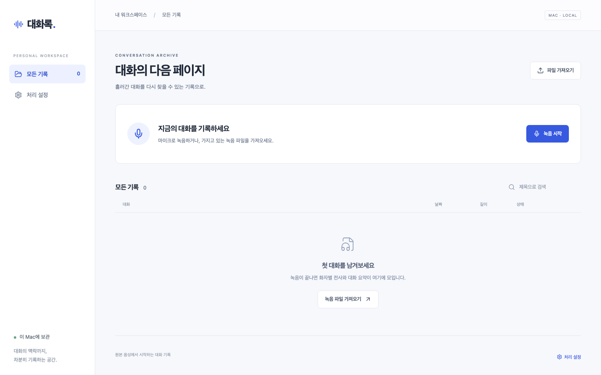
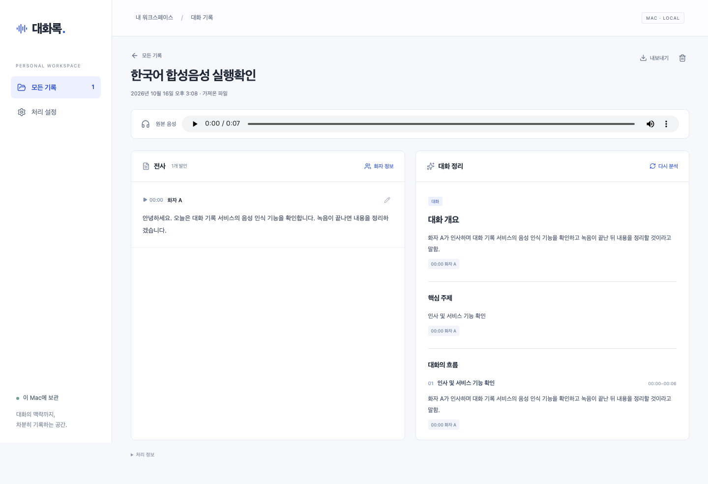

# 맥북 로컬 MVP 실행 확인

확인일: 2026-10-16. Apple M5 Pro / 메모리 48GB, Python 3.12.11, Node.js 22.23.1, FFmpeg 9.0.2. 브라우저 확인은 Playwright Chromium이다.

## 실제 로컬 모델

| 단계 | 준비한 모델 revision |
| --- | --- |
| VAD | `mlx-community/silero-vad` · `7bc17f22d3c0451bd3a6cd71e759b009271ff49a` |
| 전사 | `mlx-community/Qwen3-ASR-1.7B-8bit` · `a8379a2e2f9e313c9292cdf1af4055ab56d50d55` |
| 단어 정렬 | `mlx-community/Qwen3-ForcedAligner-0.6B-8bit` · `0e1a68e91d815300c7c9754b2a7639378b23db15` |
| 화자 구분 | `mlx-community/Nemotron-3-Diarization` · `59ed2dbfc1346dcea9d423c71306a3a2499c568f` |
| 분석 | 설치된 Ollama `gpt-oss:20b` |

macOS Yuna로 만든 7.38초 한국어 합성 음성을 사용했다. 실제 사람의 사적 녹음은 사용하지 않았다.

> 안녕하세요. 오늘은 대화 기록 서비스의 음성 인식 기능을 확인합니다. 녹음이 끝나면 내용을 정리하겠습니다.

- Qwen ASR 단독 로드·전사: 3.67초, 해당 샘플에서 입력 문장과 일치.
- 네 음성 모델을 순차 실행한 오프라인 smoke: 22.21초, 화자 1명·시간 정렬된 발언 1개, 검토 플래그 없음.
- 별도 2개 발언의 시험 전사를 Ollama로 분석: 25.35초, 한국어 구조화 결과·유효한 근거 발언 확인.
- 실제 API 파일 가져오기 → 작업자 → 로컬 전사·화자 구분 → Ollama 분석 → 결과 조회 완료. 이 실행의 DB 작업 생성~완료는 22.08초였다. 모델 캐시와 실행 상태가 서로 달라 위 단독 측정과 직접 비교할 수 없다.

첫 전체 실행에서 ForcedAligner의 한국어 선택 의존성 `soynlp` 누락을 발견해 speech extra에 추가한 뒤 다시 통과했다. 위 시간은 짧은 합성 음성의 실행 확인이며 60분 대화의 처리 시간을 예측하는 수치가 아니다.

## 자동 검사

`bash scripts/check.sh`로 다음을 통과했다.

- Ruff lint·format, 백엔드 테스트 71개
- TypeScript typecheck, 웹 컴포넌트 테스트 16개, Vite production build
- Playwright 브라우저 통합 테스트 3개
- `git diff --check`

백엔드 테스트는 실제 SQLite·파일·FFmpeg와 외부 경계의 시험 엔진을 사용한다. 브라우저 통합 테스트도 실제 입력·작업·DB API를 통과하며 모델만 테스트 모듈 안에서 고정 결과를 반환한다. 이 테스트는 모델 정확도를 측정하지 않는다.

검증한 흐름: 파일 가져오기, 전사·화자 이름·역할 수정, 버전 충돌 시 초안 유지, 수정 전 분석 표시, 다시 분석, 근거·발언에서 원본 시간으로 이동, JSON 다운로드, 새로고침 후 보존, 가상 마이크 시작·종료·최종 청크 저장. 실제 한국어 모델 결과 화면도 1440×900, 1280×800, 390×844에서 가로 넘침·스크립트 오류 없이 표시됐다. 마지막 크기는 반응형 레이아웃 확인이며 아이폰 실기기 검증을 의미하지 않는다.

마이크 통합 검증에서 Chromium WebM 헤더에 길이가 없는 사례를 발견했다. 원본을 수정하지 않고 FFmpeg 디코딩 종료 시각으로 길이를 측정하도록 보완했고, Chromium 가상 마이크로 생성한 공개 시험 fixture로 회귀를 확인했다. OS 실제 마이크의 음질·권한 UX는 아직 수동 검증하지 않았다.

독립 코드 검토에서 확인한 6개 중요 문제는 각각 실패를 재현한 뒤 수정했다.

1. 화자 편집은 창을 연 버전과 원래 값을 보관한다. 다른 탭의 변경을 현재 버전으로 우회해 덮어쓰지 않으며 충돌 시 초안을 유지한다.
2. 긴 파일 조립·검증은 기록별 파일 잠금으로 보호하고 SQLite 쓰기 트랜잭션 밖에서 실행한다. 다른 작업의 heartbeat·청크 저장을 막지 않는다. 삭제는 사용 중인 입력 잠금을 건너뛰고 이후 정리한다.
3. 외부 전사의 중복 제거는 서로 다른 요청의 실제 겹침 구간에서 같은 화자로 확인된 발언에만 적용한다. 동시에 말한 서로 다른 화자의 맞장구와 겹침 표시를 보존한다.
4. 발언 편집 초안은 가상 목록 행 밖에서 보관한다. 500개 이상의 전사 행을 스크롤해 편집 행이 사라졌다 돌아와도 초안을 유지하는 브라우저 회귀를 추가했다.
5. 추론 자식은 작업자의 lifetime pipe를 감시하는 guard가 소유한다. 강제 종료 시 자식을 회수하며, 새 작업자는 이전 추론의 종료 잠금을 확인한 후 복구한다. 결과 경로를 시도별·실행별로 분리했다.
6. 외부 요청 시작·재시도·추가 요금 가능성을 요청 전에 fsync한 이벤트로 남긴다. 성공·실패·취소 시 DB로 수집하고 재시작 시 중복 없이 복구한다. 상세 처리 정보와 JSON 내보내기에 같은 이력을 제공한다.

수정 후 동일한 한국어 합성 음성의 실제 로컬 전체 처리를 30.16초에 다시 완료했으며 처리 이력은 모두 local이었다. 실행 상태에 따른 편차가 있어 앞선 짧은 실행과 성능 비교에는 사용하지 않는다. 긴 가상 전사의 크기 관찰은 애니메이션 프레임에서 수행하도록 조정했으며, 브라우저 error 이벤트가 없는 것까지 확인했다. 실행 스크립트도 API·작업자·웹 시작 후 SIGINT 종료 코드 0, 두 웹 포트 종료, 공유 Ollama 유지까지 확인했다.

알려진 검사 경고: Starlette TestClient의 AnyIO 별칭 사용에 대한 upstream deprecation 경고와 Playwright의 색상 환경 변수 경고. 검사 실패는 아니다.

## 확인하지 않은 항목

- 실제 한국어 인터뷰·상담 정답 자료가 없어 CER·DER 목표를 검증하지 않았다.
- 30분 정답 구간, 별도 60분 연속 대화, 다대다·겹친 대화의 정확도·화자 유지, 최대 통합 메모리는 측정하지 않았다.
- 유효한 API 키가 없어 외부 전사·분석의 실제 연결, 품질, 요금을 확인하지 않았다. API 요청 형식·분할·화자 연결·재시도는 모의 경계 테스트다.
- Whisper 비교 어댑터는 구현했으나 모델을 다운로드하거나 실제 실행하지 않았다. pyannote 비교 어댑터는 실제 화자 평가 결과가 확보된 후 검토한다.
- Safari, 아이폰, LAN 접속, 화면 잠금·백그라운드 녹음은 이번 범위에 포함하지 않는다.
- 파일 암호화, 로그인, 여러 사용자, 서버 배포, 실시간 자막은 이번 MVP 범위 밖이다.

빈 평가 manifest의 실제 실행은 `status=insufficient_evidence`, `cer=null`, `der=null`, `peak_memory_bytes=null`을 반환했다. 모든 모델의 품질은 계속 **미검증**이다. [평가 방법](../../evaluation/README.md)으로 실제 자료를 추가할 수 있다.

## 구현 중 결정과 비용

| 결정 | 근거 | 달라져야 할 때의 비용 |
| --- | --- | --- |
| 맥북 loopback 웹을 첫 범위로 한정 | 사용자의 최신 지시 | 모바일 접속·TLS·페어링을 별도 구현 |
| Nemotron 3를 초기 교체 가능 어댑터로 연결 | 다대다 확장 고려, 실제 품질 미검증 | 벤치마크 후 모델 어댑터·기본값 교체 |
| 패키지 생성 전 첫 테스트에는 임시 FastAPI·테스트 의존성 사용 | 누락 패키지 대신 미구현 동작을 확인 | 설치 명령 조정만 필요 |
| 재전사 시 익명 화자 ID를 새로 생성 | 모델 출력 순서로 기존 이름을 잘못 잇지 않음 | 사용자가 재처리 후 이름을 다시 지정할 수 있음 |
| Worker가 순차 파이프라인, Exporter가 명시적 DB를 소유 | 빈 중계 클래스와 전역 상태 방지 | 필요 시 클래스만 추출 |
| 실제 자료 전까지 엔진 품질·최종 모델 미확정 | 합성 음성 실행만으로 대화 품질을 주장할 수 없음 | 실제 평가에서 품질·속도 목표 미달 시 교체 필요 |
| 통합 최대 메모리는 null | 별도 Ollama까지 측정한 값이 없음 | 메모리 용량 기준은 후속 실측 필요 |

검토자가 범위 밖으로 둔 모바일·호스팅, 실제 대화 평가, 실제 API 연결, pyannote 비교·최종 모델, 통합 메모리는 위 범위·증거 결정에 따라 유지한다. 보류한 경미한 코드 검토 지적은 없다. 구현은 현재 작업 브랜치와 워크스페이스에 보존하며 원격 게시·병합은 수행하지 않는다.

## 화면

